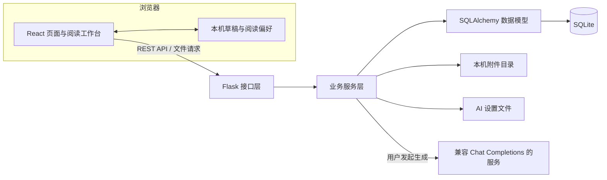
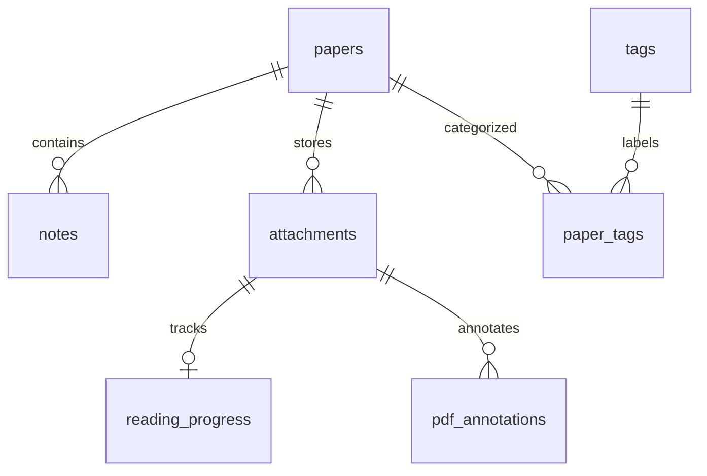

# PaperFlow 系统设计

PaperFlow 是面向个人的文献阅读与笔记管理系统。核心流程为：录入文献、阅读 PDF、摘录证据、记录理解，再通过页码回到原文核对。

本文说明系统结构、数据关系、接口约定和关键处理流程。启动与操作步骤见 [README](../README.md)，阶段实现与验证记录可从 [README 附录](../README.md#附录开发过程与记录)直接查看。

## 1. 系统架构

系统由浏览器前端、Flask 后端、SQLite 数据库和本机文件目录组成。AI 服务为可选能力，不影响基础的文献管理、阅读与笔记功能。

### 模块职责

| 模块 | 职责 |
| --- | --- |
| 前端 `pages` / `routing.ts` | 页面导航、文献列表与详情、录入、标签及 AI 设置 |
| 前端 `components` | 应用外壳、PDF 阅读、笔记编辑、附件预览与统计图表 |
| 前端 `hooks` | 请求取消与重试、共享草稿、批注保存与操作历史 |
| 前端 `api` / `types` / `utils` | 请求封装、接口类型、来源编解码、页码布局与筛选处理 |
| 后端 `routes` | 解析请求、检查资源归属、调用业务服务并返回响应 |
| 后端 `services` | 文献校验、文件事务、PDF 提取、统计及 AI 服务适配 |
| 后端 `models` / `serializers.py` | 数据关系与约束、对外响应序列化 |
| 后端 `migrations.py` | 保留已有数据的幂等升级 |

前端采用 React、TypeScript、Vite 与 Ant Design；PDF 使用 PDF.js，统计使用 ECharts，Markdown 与公式通过统一渲染组件展示。后端采用 Flask、SQLAlchemy 与 SQLite。

## 2. 数据模型

### 实体关系

| 表 | 主要字段 | 约束与用途 |
| --- | --- | --- |
| `papers` | `id`、`title`、`title_key`、`authors`、`year`、`venue`、`doi`、`url`、`abstract`、`research_topic`、`reading_status`、`is_favorite` | 标题必填；标准化标题和非空 DOI 唯一；其余文献信息可选 |
| `tags` | `id`、`name`、`name_key` | 名称必填，标准化名称唯一 |
| `paper_tags` | `paper_id`、`tag_id` | 复合主键，文献与标签的多对多关联 |
| `notes` | `id`、`paper_id`、`content` | 一篇文献可有多条在线笔记，正文非空，最多 50000 字符 |
| `attachments` | `id`、`paper_id`、`kind`、`filename`、`path`、`mime_type`、`size` | 一篇文献最多一个 `paper` 原文文件，可有多个 `note` 附件；磁盘路径使用唯一 UUID |
| `reading_progress` | `attachment_id`、`total_pages`、`current_page`、`max_page`、`last_read_at` | 绑定原文 PDF，记录页数、当前位置、历史最远位置与阅读事件 |
| `pdf_annotations` | `id`、`attachment_id`、`page`、`kind`、`color`、`geometry`、`text` | 绑定具体 PDF，保存画线、高亮和文字批注 |

文献、笔记等实体使用 `created_at`、`updated_at` 记录操作时间；接口序列化为带 `Z` 后缀的 UTC 字符串。批注仅记录 `created_at`。

### 校验与删除规则

- 标题最长 500 字符，作者 1000 字符，期刊或会议 500 字符，摘要 50000 字符，研究主题 200 字符。作者可为空，年份可为空并由服务层验证有效范围。
- 标签名最长 50 字符，单篇文献最多关联 100 个标签。标题和标签按 Unicode NFKC、空白合并及大小写折叠进行去重，保留原显示文本。
- DOI 移除 `doi.org` 前缀并转为小写，未填写时保存为 `NULL`。来源链接只接受 HTTP / HTTPS。
- 资源 ID 使用有效正整数。外键、复合主键及唯一索引用于约束归属和重复数据；SQLite 每次连接启用外键检查。
- 删除文献会级联删除在线笔记、附件、阅读进度、PDF 批注和标签关联；标签本身保留。删除标签只解除关联，不删除文献。
- 附件 ID 不复用。替换 PDF 使用新的附件记录，旧来源不会自动指向新文件。

## 3. 页面与状态组织

前端使用 Hash 路由，支持直接打开和刷新。

| 地址 | 用途 |
| --- | --- |
| `/#/dashboard` | 首页概览、最近阅读与标签入口 |
| `/#/papers` | 文献库，支持筛选、排序、分页及视图切换 |
| `/#/papers/new` | 录入文献与上传原文 |
| `/#/papers/{id}` | 文献详情、在线笔记及附件 |
| `/#/papers/{id}/edit` | 修改文献信息或替换原文 |
| `/#/papers/{id}?read=1` | 进入文献并打开阅读工作台 |
| `/#/tags` | 标签管理 |
| `/#/settings/ai` | AI 服务配置与连接测试 |

文献库查询条件编码到地址参数，并通过会话存储保留返回位置。首页标签入口直接打开对应筛选结果；最近阅读提供直接打开工作台的入口。

| 状态 | 保存位置 | 作用 |
| --- | --- | --- |
| 文献信息、正式笔记、进度与批注 | SQLite | 通过后端统一读写 |
| 原文与笔记附件 | 本机文件目录 | 数据库存储归属及文件引用 |
| 笔记草稿 | 浏览器本地存储与共享内存状态 | 详情和阅读器共享编辑内容，可收起、切换和恢复 |
| 布局、分栏比例、页内偏移及视图偏好 | 浏览器本地存储 | 恢复同一浏览器的阅读习惯 |
| 列表查询与返回位置 | 地址参数和浏览器会话存储 | 从详情返回时恢复筛选与列表位置 |
| AI 生成结果、选区与批注操作历史 | 页面内存 | 用户明确保存后才写入正式数据 |

## 4. REST API

接口统一以 `/api` 为前缀。普通成功响应使用 `{ "data": ... }`，错误响应使用 `{ "error": { "code": "...", "message": "...", "details": {} } }`。文件读取成功返回二进制内容。

创建返回 `201`，读取与更新返回 `200`，删除返回 `204`。请求校验、资源缺失、重复冲突和请求体过大分别使用 `400`、`404`、`409`、`413`；AI 无可分析内容使用 `422`。异常经过统一处理，不返回数据库或服务密钥等内部信息。

### 文献、标签与笔记

| 方法 | 路径 | 功能 |
| --- | --- | --- |
| GET | `/health` | 检查服务及数据库连接 |
| GET | `/dashboard` | 文献数量、收藏、阅读状态、年份、标签与最近阅读聚合 |
| GET / POST | `/papers` | 分页查询 / 创建文献 |
| GET / PATCH / DELETE | `/papers/{id}` | 查询详情 / 修改文献 / 删除文献及关联内容 |
| PUT / DELETE | `/papers/{id}/tags/{tag_id}` | 幂等添加 / 移除标签关联 |
| GET / POST | `/tags` | 查询标签及关联数量 / 创建标签 |
| DELETE | `/tags/{id}` | 删除标签及关联 |
| GET / POST | `/papers/{id}/notes` | 查询笔记 / 创建笔记 |
| PATCH / DELETE | `/notes/{id}` | 修改 / 删除在线笔记 |

文献查询参数：

| 参数 | 规则 |
| --- | --- |
| `q`、`title`、`author` | 标题或作者的字面子串查询；`%`、`_` 不作为通配符 |
| `tag_id`、`year`、`reading_status` | 标签、出版年份与阅读状态筛选 |
| `research_topic` | 研究主题完整匹配 |
| `is_favorite` | `true` / `false` |
| `sort_by` | `created_at` / `updated_at` / `title` / `year` |
| `sort_order` | `asc` / `desc` |
| `page`、`page_size` | 默认第 1 页、每页 20 条，每页上限 100 条 |

多个条件按 AND 组合，默认按 `created_at` 降序，同值以 ID 排序，空年份置后。前端合并连续输入后发起查询，条件变化回到第一页，并取消失效请求。详情响应除文献信息外还包含标签、笔记、`paper_file`、`note_attachments` 和阅读进度。

### 文件、阅读进度与批注

| 方法 | 路径 | 功能 |
| --- | --- | --- |
| POST | `/papers/parse-pdf` | 提取 PDF 候选信息，不创建文献、不保存文件 |
| POST | `/papers/{id}/note-attachments` | 上传笔记附件 |
| GET / DELETE | `/files/{id}` | 查看或下载 / 删除附件 |
| PUT | `/files/{id}/reading-progress` | 保存原文页数、当前位置及阅读事件 |
| GET / POST | `/files/{id}/annotations` | 查询 / 创建 PDF 标记 |
| PUT / DELETE | `/files/{id}/annotations/{annotation_id}` | 修改 / 删除 PDF 标记 |

有原文上传或替换时，文献 POST / PATCH 接口接收 `multipart/form-data`：`data` 为文献 JSON 字符串，`file` 为 PDF；无文件时仍接收 JSON。上传笔记附件使用 `file` 字段。读取文件可用 `?download=1` 指定下载，DOCX 始终按附件返回。

### AI 能力与配置

| 方法 | 路径 | 功能 |
| --- | --- | --- |
| GET | `/ai/status` | 查询本地配置是否可用，不请求外部服务 |
| GET / PUT | `/ai/settings` | 读取公开设置 / 保存配置 |
| POST | `/ai/settings/test` | 测试未保存的表单配置，不保存设置 |
| POST | `/papers/{id}/ai/analysis` | 生成结构化论文分析 |
| POST | `/papers/{id}/ai/keywords` | 生成关键词候选 |
| POST | `/papers/{id}/ai/reading-summary` | 结合在线笔记生成阅读总结 |
| POST | `/papers/{id}/ai/explain` | 解释指定页码和选中片段 |
| POST | `/papers/{id}/ai/keywords/apply` | 将确认的关键词合并到文献标签 |

生成接口不直接修改文献或笔记。保存总结复用笔记创建接口；关键词仅在确认添加时写入，重复确认不会重复关联。

## 5. PDF 阅读与进度

PDF 使用连续页面布局，只渲染视口附近的画布与文字层。页面占位保持稳定，滚动、页码输入和缩略图使用同一套定位逻辑；缩放和分栏变化保留页内相对位置。

阅读进度请求为 `{ total_pages, current_page, read }`。页数与页码必须为有效整数，`read` 必须为布尔值；同一附件的总页数不一致时返回冲突错误。

- 打开和恢复使用 `read=false`，不增加历史最远页码。
- 主动阅读事件使用 `read=true`，后端通过原子更新保证 `max_page` 不回退。
- 进度由后端计算：未发生阅读事件为 0%，到达末页为 100%，其余限制在 1%～99%。它表示到达位置，不代表逐页精读或理解程度。
- 进度对应 `not_started`、`reading`、`completed`；完成状态不会因回看或替换 PDF 自动回退。新附件单独记录进度。
- 前端串行保存阅读事件，失败保留队列并提供重试，未同步内容有明确提示。PDF 加载或渲染失败可重试或下载原文。

## 6. 在线笔记与来源关联

笔记正文保存在 `notes.content`，由带版本的结构化元数据和可读 Markdown 组成。版本 1 保留单段摘录，版本 2 支持多段摘录；普通 Markdown 和旧摘录模板继续兼容。

| 结构 | 内容 |
| --- | --- |
| 主来源 `NoteSource` | `fileId`、`page`、`kind`、可选 `rects`；来源类型为手动页码、摘录或旧高亮 |
| 理解与标签 | `understanding`、`tags`；旧 `chapter` 字段保留，但不作为新笔记首行输入 |
| 摘录列表 `excerpts` | 每段包含 `text` 和可选来源，可关联不同页码 |

手动笔记可指定主来源页码，也可选择全文笔记。摘录加入已有草稿时保留理解与其他片段，同一附件、页码和文字的重复摘录不再添加。每段来源独立回跳，有选区时定位到目标句并短暂强调；手动页码关联不生成文字高亮。

元数据放在 Markdown 注释中，并保留一份可读正文。正文与元数据不一致或格式损坏时回退显示原文，避免隐藏用户修改。替换原文后，旧来源保留，但需要重新关联具体附件。

草稿按文献区分，详情与阅读工作台使用共享状态。输入保存在本机，正式保存成功才清理对应草稿；存储失败会明确提示，损坏的缓存按条忽略。草稿恢复不等于已提交数据库。

## 7. PDF 标记与操作历史

标记保存在 `pdf_annotations`，属于阅读层，不直接修改原始 PDF。

| 类型 | 几何数据 | 操作 |
| --- | --- | --- |
| `pen` | `points`：页内坐标点序列 | 自由画线、选中、改色和删除 |
| `highlight` | `rects`：选区矩形列表 | 文字高亮、选中、改色和删除 |
| `text` | `x`、`y`，可选 `width`、`height`、`fontSize` | 编辑文字、拖动、调整尺寸、修改字号与颜色 |

坐标与框尺寸按页面比例保存，字号按页面宽度比例保存。后端检查类型、颜色、页码、数量和边界，旧文字批注缺少尺寸字段时使用兼容默认值。文字内容最多 2000 字符。

拖动和缩放即时预览，在操作结束后保存；失败保留待恢复状态。操作历史保存本次打开期间最多 50 步撤销／重做，恢复已删标记时同步更新历史引用。笔记来源提示与可擦除高亮使用不同语义，删除标记不会删除笔记理解。

下载入口返回原始 PDF，不包含站内批注。

## 8. 文件与事务一致性

单文件最大 25 MB；原文只接收 PDF，笔记附件支持 PDF、DOCX、MD、TXT。上传同时检查扩展名、MIME 和基本内容，原始文件名仅用于展示与下载，接口不暴露磁盘路径。

PDF 信息提取使用独立子进程，受 12 秒超时限制。元信息和前两页文本用于预填，前端只填空字段，用户确认保存才写入文献和附件。识别结果是候选信息，扫描件不提供 OCR。

创建文献、关联标签和保存附件引用在同一业务事务中完成。替换或删除文件先移入隔离区：数据库提交失败时恢复，成功后清理。初始化命令可恢复异常中断留下的文件并回收无引用文件，不应通过直接删除数据库记录代替文件接口。

SQLite 保存文献、正式笔记和文件引用；附件与 AI 设置放在 `backend/instance/`。备份应在服务停止后同时保留数据库和文件目录。数据库升级采用幂等迁移，保留文献 ID、已有笔记、附件及关联关系。

## 9. AI 输入与执行边界

AI 服务适配器负责配置、提示词、HTTP 调用和响应校验；上下文构造独立于路由，生成失败不改动原始数据。

| 输入 | 范围 |
| --- | --- |
| 文献信息与摘要 | 标题、作者、年份、来源等；摘要最多 6000 字符 |
| PDF 正文 | 最多抽取 24 页、24000 字符，并说明抽样或截取情况 |
| 阅读总结的在线笔记 | 最多 20 条，共用 8000 字符预算，不解析笔记附件 |
| 片段解释 | 校验原文附件归属，接收页码及最多 8000 字符的选区 |

无法提取正文时可回退到摘要；正文和摘要均为空则拒绝生成。上下文不包含笔记隐藏元数据。接口返回输入来源与范围说明，AI 输出复用 Markdown / LaTeX 组件展示，用户确认后才追加或保存。

配置可由环境变量、`.env` 或网页设置提供，网页保存值优先。密钥只在后端使用，不回传前端；设置文件采用原子写入。配置接口限制本机来源，写请求还校验专用请求头。

连接测试发送固定测试内容，不读取文献或笔记。生成请求不自动重试；取消前端等待不保证上游服务停止计算。真实服务的认证、模型质量与额度需要独立联调。

## 10. 部署与验证

项目面向本机个人使用，默认后端为 `127.0.0.1:5000`、前端为 `127.0.0.1:5173`，开发服务代理 `/api` 到后端。没有账号系统、多用户权限、RAG、向量数据库或 OCR。

Markdown 不执行原始 HTML，危险链接被过滤；公式渲染关闭信任模式。PDF 字体、CMap 和解码资源由项目本地准备。

后端测试覆盖 API、事务回滚、文件处理、进度、批注与 AI 边界；前端测试覆盖请求、路由、笔记来源、草稿、筛选和页码布局。浏览器验收使用独立数据库和上传目录，AI 交互可使用本地测试替身。

启动及检查命令见 [README](../README.md)，完整功能验证见[最终阶段记录](phase-9-verification.md)。

## 11. 关键设计取舍与验证依据

### 最小录入与逐步补全

题目要求核心信息缺失时有提示。最终版本将标题作为必填核心字段，其他元信息允许稍后完善：本地 PDF 解析可能拿不到作者或年份，强制这些字段会阻断真实阅读流程。第一、二阶段曾要求作者必填，第六阶段明确修改了这项需求。前后端采用同一规则，标题缺失仍拒绝保存；验证见 `test_stage6_files.py::test_title_only_and_empty_authors_are_valid` 和[AI 辅助开发记录](ai-development.md#6-文件导入与字段调整)。

### 业务校验与数据库约束配合

服务层先校验字段、关联标签和重复值，再修改 ORM 对象，使错误能够定位到用户输入；数据库的唯一索引、检查约束、外键与关联表复合主键提供最终约束。标题采用 NFKC、空白合并与大小写折叠后的键查重，DOI 去除前缀并统一大小写。编辑发生冲突时不保留部分修改，验证见 `test_api.py::test_failed_update_is_atomic`、`test_stage2_crud.py::test_duplicate_edit_preserves_tags_and_metadata`。

### 关联归属与删除闭环

笔记创建路径包含文献 ID，先查到文献后由服务关联；更新只接受正文，不能提交另一个 `paper_id` 转移归属。数据库外键拒绝孤立笔记。文献删除清理从属笔记、文件引用、进度、批注和标签关系；共享标签仍可服务其他文献。磁盘附件通过文件事务隔离与回滚，避免数据库操作失败但原 PDF 已消失。验证见 `test_stage2_crud.py::test_many_to_many_and_note_isolation`、`test_stage6_files.py::test_database_failure_restores_files`。

### 统计口径与状态一致性

首页统计由数据库全量聚合，不使用列表当前页；文献总量、阅读状态和年份分别按文献计数，标签数量按关系计数，因此标签计数总和可以大于文献总数。文献有多条笔记或多个标签时，文献总数也只计一次；空年份单独保留，空状态补零。已读完状态不会因回看降低，阅读页码表示到达位置。验证见 `test_stage5_dashboard.py`，该组测试包含多关系重复计数、超过首页分页数量及增删改后的统计检查。

### 个人工具的技术边界

SQLite 与本机目录适合单机保存和备份；Flask 工厂及分层服务便于测试时替换数据库、上传目录和 AI 配置；前端 TypeScript 类型与统一请求层减少接口格式分歧。当前服务采用本机开发启动方式，不含账号或多人协作权限。该取舍对应课程个人知识管理题目，并降低安装与现场验收成本。

### AI 候选结果与正式数据分开

AIService 只负责服务适配和结果校验，上下文构造负责输入范围，业务路由负责用户确认后的写入。这样生成失败不修改数据库，关键词可以只选部分，阅读总结另建笔记保留个人原文。测试可用本地 HTTP 替身稳定验证协议与异常；真实模型的理解质量需单独联调，不能由模拟结果推定。验证见 `test_stage7_ai.py`、`test_stage7_settings.py` 与[第七阶段记录](phase-7-verification.md)。

相关实现与测试见[功能验收说明](assessment.md)。
