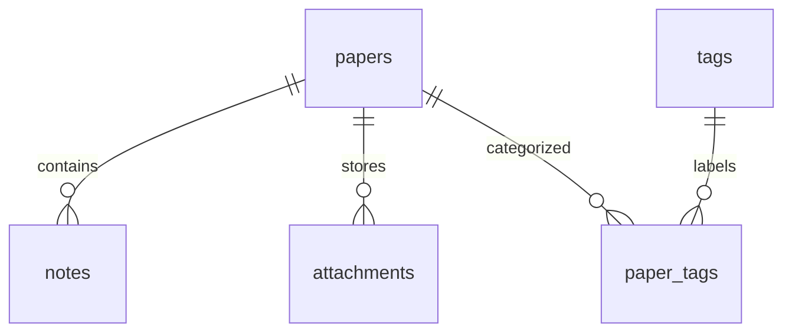

# PaperFlow 设计与开发计划

> 当前进度（2026-10-23）：第一至第六阶段均已完成。实际阶段划分以各阶段提示词为准，与 [README 开发阶段](../README.md#开发阶段) 保持一致；当前停在第六阶段，后续范围待用户指定。

## 当前实现范围

已完成项目骨架、SQLite 数据库、后端 REST API、核心 CRUD 验收、自动化测试及 Windows 启动说明。前端已具备文献列表、新增、编辑、详情、标签管理和阅读笔记操作，支持多标签、阅读状态、收藏与分页。第四阶段新增标题 / 作者搜索、标签 / 年份 / 阅读状态 / 研究主题组合筛选，以及年份 / 创建时间 / 更新时间升降序排序，全部通过既有 API 查询数据库。第五阶段完成 Dashboard 四项统计和 ECharts 阅读状态、年份分布图表；真实 AI 调用尚未开发。

## 数据库

时间统一保存为 UTC，接口以 ISO 8601（Z 后缀）返回；文献年份可不填，填写时必须为 1000 至当前年份加 1 的整数。作者第一版作为文本存储，便于录入多位作者。

| 表 | 字段 | 约束与用途 |
| --- | --- | --- |
| papers | id | 整数主键 |
| papers | title, title_key | 标题必填，最长 500 字符；title_key 为标准化标题，唯一索引 |
| papers | authors | 选填，默认空字符串，最长 1000 字符 |
| papers | year | 可空；数据库限制 1000–9999，服务层限制不晚于明年 |
| papers | venue | 期刊或会议，最长 500 字符 |
| papers | doi | 可空，最长 255 字符，唯一索引；移除 doi.org 前缀并转小写 |
| papers | url | 可空，仅接受 HTTP/HTTPS，最长 2048 字符 |
| papers | abstract | 摘要，最长 50000 字符 |
| papers | research_topic | 研究主题，最长 200 字符，有索引 |
| papers | reading_status | not_started / reading / completed，默认 not_started，有检查约束及索引 |
| papers | is_favorite | 布尔值，默认 false |
| papers | created_at, updated_at | 创建与修改时间 |
| tags | id, name, name_key, created_at | 标签名必填，最长 50 字符；标准化 name_key 唯一 |
| paper_tags | paper_id, tag_id | 复合主键，两侧外键均 ON DELETE CASCADE，避免重复关联 |
| notes | id, paper_id, content, created_at, updated_at | 文献外键必填且有索引；内容非空，最长 50000 字符；ON DELETE CASCADE |
| attachments | id, paper_id, kind, filename, path, mime_type, size, created_at | 必须绑定文献；kind 为 paper / note；单篇最多一个 paper 文件，note 可多个；path 是 UUID 相对路径且唯一；外键级联删除 |

文献与标签为多对多，文献与笔记为一对多。删除文献同时删除其笔记和标签关联，不删除标签；删除标签只删除标签及关联，保留文献。SQLite 每次连接均启用外键。标题和标签按 Unicode NFKC、合并连续空白、casefold 标准化，原显示文本保留；不同大小写的同名内容视为重复。未填写 DOI 用 NULL 保存，允许多条文献没有 DOI。



## REST API

前缀 `/api`。成功返回 `{ "data": ... }`，错误返回 `{ "error": { "code": "...", "message": "...", "details": {} } }`。创建返回 201，更新和查询返回 200，删除返回 204（无响应体）。校验错误 400、资源不存在 404、重复冲突 409、请求体过大 413、数据库异常 500。普通修改请求使用 JSON 对象，未知字段会拒绝；携带文件时使用 multipart/form-data。文件读取成功返回二进制，失败仍返回统一 JSON 错误。

| 方法 | 路径 | 功能 |
| --- | --- | --- |
| GET | /health | 实际执行数据库查询，检查服务与数据库连接 |
| GET | /papers | 分页搜索、筛选、排序；返回 items、total、page、page_size、pages |
| POST | /papers | 新增文献，可提交 tag_ids |
| GET | /papers/{id} | 文献详情，含标签与笔记 |
| PATCH | /papers/{id} | 部分更新；tag_ids 用于整体替换标签 |
| DELETE | /papers/{id} | 删除文献及其笔记和标签关联 |
| PUT | /papers/{id}/tags/{tag_id} | 幂等添加标签 |
| DELETE | /papers/{id}/tags/{tag_id} | 幂等移除标签；两侧资源必须存在 |
| GET | /tags | 标签列表，含关联文献数量 |
| POST | /tags | 创建标签，body 为 name |
| DELETE | /tags/{id} | 删除标签 |
| GET | /papers/{id}/notes | 按修改时间倒序返回笔记 |
| POST | /papers/{id}/notes | 新建笔记，body 为 content |
| PATCH | /notes/{id} | 编辑笔记内容，不允许更改归属文献 |
| DELETE | /notes/{id} | 删除笔记 |
| POST | /papers/parse-pdf | multipart 的 file 字段上传 PDF，返回 fields / recognized / missing / warning；只识别不保存 |
| POST | /papers/{id}/note-attachments | multipart 的 file 字段上传笔记附件，必须绑定存在的文献 |
| GET | /files/{id} | 查看文件；`?download=1` 指定下载；DOCX 始终返回 attachment |
| DELETE | /files/{id} | 删除单个论文 / 笔记文件，保留文献和其他笔记 |
| GET | /dashboard | 文献总数、收藏数、状态分布、年份分布和标签分布，全部查询数据库 |

文献列表参数：`q`（标题或作者）、`title`、`author`、`tag_id`、`year`、`reading_status`、`research_topic`、`is_favorite=true/false`、`sort_by=created_at/updated_at/title/year`、`sort_order=asc/desc`、`page`（默认 1）、`page_size`（默认 20，上限 100）。多个筛选条件按 AND 组合；关键词采用字面子串匹配（% 和 _ 不作为通配符），主题精确匹配。默认按创建时间倒序，同值按 id 排序，空年份始终排在后面。SQLite 的 LIKE 对 ASCII 大小写不敏感，中文按字面匹配，暂不提供全文检索或拼音检索。

新增示例：

```json
{
  "title": "Attention Is All You Need",
  "authors": "Ashish Vaswani et al.",
  "year": 2017,
  "venue": "NeurIPS",
  "doi": "10.48550/arXiv.1706.03762",
  "url": "https://arxiv.org/abs/1706.03762",
  "abstract": "本文提出 Transformer 架构。",
  "research_topic": "自然语言处理",
  "reading_status": "reading",
  "is_favorite": true,
  "tag_ids": []
}
```

并发情况下依靠数据库唯一约束兜底；业务错误不泄漏数据库连接信息。修改文献及关联标签在一次事务中提交，失败回滚。统计不缓存；第五阶段概览页在挂载、窗口恢复焦点、页面重新可见或手动刷新时重新拉取，旧请求沿用取消机制。第一版只供本机个人使用，无登录和权限，服务默认绑定 127.0.0.1。

第二阶段补充：资源 ID 使用 1 至 9223372036854775807 范围内的整数。路径中的 0 或超范围 ID 返回 404；JSON `tag_ids` 中非法类型或超范围值返回 400；范围内但不存在的标签返回 404。校验失败不改变文献及其关联数据。

## 开发顺序与验收

| 阶段 | 实际范围 | 状态与验收 |
| --- | --- | --- |
| 第一阶段：项目基础 | 应用工厂、数据模型、初始化命令、基础 API、统一异常、AIService 占位、前端应用壳 | [已完成](phase-1-verification.md) |
| 第二阶段：核心业务 CRUD | 文献 / 标签 / 笔记及关联操作验收，超范围 ID 校验修复，真实 HTTP 测试 | [已完成](phase-2-verification.md) |
| 第三阶段：前端核心页面 | 文献列表 / 新增 / 编辑 / 详情、标签管理、阅读笔记，状态与收藏更新，分页及加载 / 空 / 错误状态 | [已完成](phase-3-verification.md) |
| 第四阶段：搜索、筛选和排序 | 六种条件组合查询、三种字段升降序、自动刷新、分页联动、清空筛选和无结果提示 | [已完成](phase-4-verification.md) |
| 第五阶段：Dashboard 和统计可视化 | 四项统计卡片、阅读状态环形图、年份柱状图、自动刷新及加载 / 空 / 错误状态 | [已完成](phase-5-verification.md) |
| 第六阶段：文件管理与阅读体验 | PDF 原文、笔记附件、本地信息提取、Markdown / LaTeX、阅读进度与恢复、随读笔记、异常回滚、旧库升级与 UI | [已完成](phase-6-verification.md) |
| 后续阶段 | 具体范围待后续要求确定 | 未开始 |

第三阶段建立 Hash 路由、统一 API 客户端、共享表单与笔记组件。第四阶段在现有列表中加入独立筛选栏，用 URLSearchParams 编码条件，连续输入合并为 300 毫秒后查询，条件与页码一起更新；旧请求沿用取消机制。标题 / 作者为字面子串匹配，主题精确匹配，多条件按 AND 组合；清空恢复创建时间降序与第一页。非法年份不发起新查询，并提示当前展示上次有效结果。未改动后端接口和表结构。

第五阶段启用 `/#/dashboard`，继续以文献库作为默认首页。使用现有 `GET /api/dashboard` 返回的 `total`、`completed`、`reading`、`not_started`、`by_status` 和 `by_year`；不从分页列表推算总数，不在页面写死统计。年份按升序、空年份最后展示，图表更新整体替换数据以移除已消失的分类。ECharts 使用按需模块、SVG 渲染、ResizeObserver 自适应及卸载销毁。没有新增 API、数据库迁移或依赖，也没有开发 AI。完成第五阶段后停止。

每阶段运行检查并记录结果。第一版不接入 AI、不做用户系统、RAG、向量数据库、Redis 或微服务。AIService 只定义未来接口，密钥仅从环境变量读取，不发送外部请求。

## 第六阶段补充设计

- 新建 / 编辑文献继续接受原有 JSON；有 PDF 时使用同一路径 POST / PATCH，multipart 含 `data`（文献 JSON 字符串）和 `file`。校验完后在一个事务中保存文献、标签和附件引用，文件写入失败不会保存半篇文献。
- 详情响应增加 `paper_file: Attachment | null` 与 `note_attachments: Attachment[]`。附件响应包含 id、paper_id、kind、filename、mime_type、size、created_at，不暴露磁盘路径。附件自身不承载在线笔记文本，两者独立绑定同一文献。
- 附件文件名使用随机 UUID，原始文件名只用于展示 / 下载；拒绝非法扩展名、MIME、空文件、超过 25 MB 的文件。PDF 检查魔数，DOCX 检查 ZIP 必需条目，MD / TXT 检查 UTF-8 文本；这不是完整文档修复或恶意文件扫描。
- pypdf 解析运行在独立子进程，12 秒超时，优先取 metadata 标题 / 作者，结合前两页文本识别其他字段。PDF 创建日期不当作出版年份。无 AI、无 OCR、无网络检索；识别不准确时由用户修正。识别失败只影响预填，保存独立校验并接收原文件。
- 前端解析只填空字段，保留用户现有输入，展示已识别 / 未识别字段和候选值；取消录入不产生磁盘文件。替换原文保存前确认，删除附件及文献前确认。
- PDF 阅读使用懒加载的 PDF.js 和本地字体 / CMap / WASM，提供单页画布、上一页 / 下一页、页码和缩放；MD 使用 react-markdown + remark-gfm 渲染并可切换源码，HTML 转义且危险 URL 被过滤；TXT 以纯文本预览；DOCX 下载到本地阅读。文件请求失败统一提示，不打开无错误说明的空页。
- 替换 / 删除使用文件隔离和数据库事务：提交失败回滚记录并恢复旧文件；提交成功清理隔离文件。`init-db` 在服务停止时恢复异常中断操作并回收孤儿文件。直接在数据库中执行 SQL 删除无法触发物理文件清理，应使用 API，或停机后运行 `init-db` 恢复一致性。
- `migrations.py` 重建旧 papers 表以移除作者非空 CHECK；在同一个 SQLite 显式事务中复制原字段、保持 ID、恢复已知索引并检查外键，失败回滚。随后创建缺失附件表，重复执行无破坏性。升级前停止服务并备份数据库及上传目录。

## 技术参考

- [Flask 安装及虚拟环境](https://flask.palletsprojects.com/en/stable/installation/)
- [Flask-SQLAlchemy 应用工厂与 SQLAlchemy 2 查询](https://flask-sqlalchemy.palletsprojects.com/en/stable/quickstart/)
- [Vite 启动与构建](https://vite.dev/guide/)
- [ECharts 图表容器、自适应与销毁](https://echarts.apache.org/handbook/en/concepts/chart-size/)
- [pypdf PdfReader 与元信息](https://pypdf.readthedocs.io/en/stable/modules/PdfReader.html)
- [Mozilla PDF.js 本地渲染示例](https://mozilla.github.io/pdf.js/examples/)

第六阶段 UI 补充：详情采用摘要 / 笔记主区与论文信息侧栏；原文卡片突出进度与最近阅读时间，在线笔记和附件使用页签切换，危险操作放入更多菜单。文献库改用双列内容卡片，保留分页、搜索、全部高级筛选与排序。阅读空间采用 PDF / 笔记双栏，窄屏上下排列。MarkdownView 在在线笔记、编辑预览和附件预览间共用，使用 remark-math 与 rehype-katex 渲染公式；支持美元符号与反斜杠括号分隔符，代码内容不转换，KaTeX trust 关闭，资源本地打包。

10 月 25 日补充：ReaderNotes 在阅读空间内提供上传笔记与在线笔记页签，有附件时默认展示上传笔记。文件选择器使用当前论文的 note_attachments，MD / PDF / TXT 内嵌预览，DOCX 保留本地打开。切换文件会取消旧请求并释放 Blob URL；笔记 PDF 不传递原文进度回调。ReadingSplitPane 使用指针捕获实现拖动、键盘方向键调整与双击复位，宽度比例保存在 localStorage，存储不可用时仍能调整；不重建左侧 PDF 阅读器，窄屏隐藏分隔条并上下排列。

### 阅读进度（2026-10-24）

- 新表 `reading_progress`：`attachment_id` 为主键和外键，引用 attachments，ON DELETE CASCADE；保存 `total_pages`、`current_page`、`max_page`、`last_read_at`。百分比由后端计算。`init-db` 创建缺失表，不重写已有论文与附件。
- `PUT /api/files/:id/reading-progress` 接收 `{total_pages, current_page, read}`，仅用于论文 PDF。页码为整数且不超过总页数；总页数由 PDF.js 读取并首次登记，同一文件后续页数不符返回 409。客户端不提交状态、百分比和时间。
- 初次打开 / 恢复以 `read=false` 登记，不增加最大页码、不更新时间；用户翻页或跳页成功渲染、主动向下滚到页底、本页已读按钮提交 `read=true`。无任何阅读事件时最大页码为 0。进度表示历史最远阅读位置，并非逐页阅读时长或理解程度。
- SQLite 原子 upsert 使用 `max(历史值, 新页码)`，旧位置不会覆盖更远进度。当前页按最后收到的操作保存。前端串行提交事件，失败保留队列供重试；未完成同步时阻止普通关闭，提供明确的放弃入口及刷新前提示。
- 进度 0 / 1～99 / 100 对应未开始 / 阅读中 / 已读完。论文完成状态通过条件更新保持，即使编辑或更换 PDF 也不回退。替换 / 删除附件级联移除旧文件的进度；新 PDF 独立记录。
- 文献列表、详情增加 `reading_progress`，附件也返回同字段。列表预加载附件 / 进度避免逐篇附加查询，Dashboard 继续直接聚合 papers.reading_status。
- PDF 加载与渲染各设 30 秒超时和重试；错误不计入阅读。组件懒加载异常由错误边界展示重新加载入口，避免空白；读取失败可下载原文。
