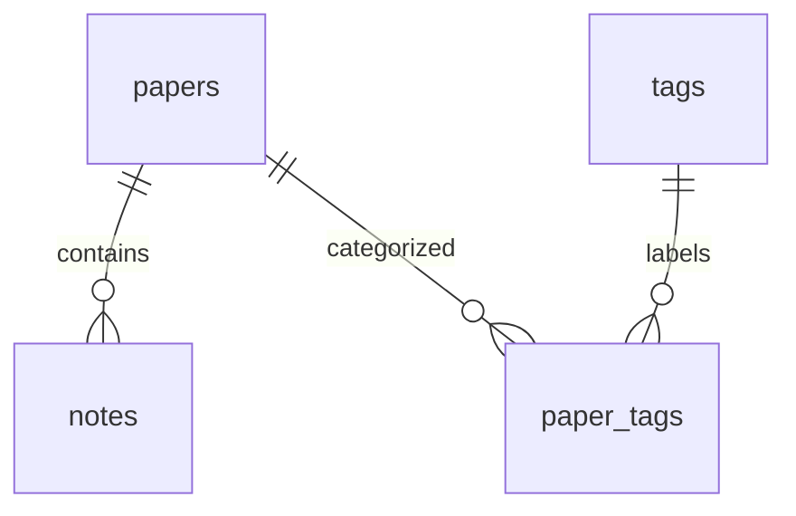

# PaperFlow 设计与开发计划

> 阶段调整（2026-10-21）：用户后续提供的 `第二阶段.txt` 将第二阶段明确为核心业务 CRUD 验收，优先于下文最初计划中的界面开发顺序。本阶段沿用已有 REST API，修复超范围 ID 校验，补充数据关联与真实 HTTP 测试；不扩展 Dashboard、AI 或 UI。结果见 [第二阶段验收记录](phase-2-verification.md)。下文保留第一阶段设计背景。

## 本轮范围

按初稿提示词分阶段交付。本轮完成第一阶段：项目骨架、SQLite 数据库、后端基础 REST API、自动化测试及 Windows 启动说明。前端仅提供应用壳与后端连通性检查，完整管理界面在后续阶段实现。

## 数据库

时间统一保存为 UTC，接口以 ISO 8601（Z 后缀）返回；文献年份可不填，填写时必须为 1000 至当前年份加 1 的整数。作者第一版作为文本存储，便于录入多位作者。

| 表 | 字段 | 约束与用途 |
| --- | --- | --- |
| papers | id | 整数主键 |
| papers | title, title_key | 标题必填，最长 500 字符；title_key 为标准化标题，唯一索引 |
| papers | authors | 必填，最长 1000 字符 |
| papers | year | 可空；数据库限制 1000–9999，服务层限制不晚于明年 |
| papers | venue | 期刊或会议，最长 500 字符 |
| papers | doi | 可空，最长 255 字符，唯一索引；移除 doi.org 前缀并转小写 |
| papers | url | 可空，仅接受 HTTP/HTTPS，最长 2048 字符 |
| papers | abstract | 摘要，最长 50000 字符 |
| papers | research_topic | 研究主题，最长 200 字符，有索引 |
| papers | reading_status | not_started / reading / completed，默认 not_started，有检查约束及索引 |
| papers | is_favorite | 布尔值，默认 false |
| papers | created_at, updated_at | 创建与修改时间 |
| tags | id, name, name_key, created_at | 标签名必填，最长 50 字符；标准化 name_key 唯一 |
| paper_tags | paper_id, tag_id | 复合主键，两侧外键均 ON DELETE CASCADE，避免重复关联 |
| notes | id, paper_id, content, created_at, updated_at | 文献外键必填且有索引；内容非空，最长 50000 字符；ON DELETE CASCADE |

文献与标签为多对多，文献与笔记为一对多。删除文献同时删除其笔记和标签关联，不删除标签；删除标签只删除标签及关联，保留文献。SQLite 每次连接均启用外键。标题和标签按 Unicode NFKC、合并连续空白、casefold 标准化，原显示文本保留；不同大小写的同名内容视为重复。未填写 DOI 用 NULL 保存，允许多条文献没有 DOI。



## REST API

前缀 `/api`。成功返回 `{ "data": ... }`，错误返回 `{ "error": { "code": "...", "message": "...", "details": {} } }`。创建返回 201，更新和查询返回 200，删除返回 204（无响应体）。校验错误 400、资源不存在 404、重复冲突 409、请求体过大 413、数据库异常 500。所有修改请求使用 JSON 对象，未知字段会拒绝。

| 方法 | 路径 | 功能 |
| --- | --- | --- |
| GET | /health | 实际执行数据库查询，检查服务与数据库连接 |
| GET | /papers | 分页搜索、筛选、排序；返回 items、total、page、page_size、pages |
| POST | /papers | 新增文献，可提交 tag_ids |
| GET | /papers/{id} | 文献详情，含标签与笔记 |
| PATCH | /papers/{id} | 部分更新；tag_ids 用于整体替换标签 |
| DELETE | /papers/{id} | 删除文献及其笔记和标签关联 |
| PUT | /papers/{id}/tags/{tag_id} | 幂等添加标签 |
| DELETE | /papers/{id}/tags/{tag_id} | 幂等移除标签；两侧资源必须存在 |
| GET | /tags | 标签列表，含关联文献数量 |
| POST | /tags | 创建标签，body 为 name |
| DELETE | /tags/{id} | 删除标签 |
| GET | /papers/{id}/notes | 按修改时间倒序返回笔记 |
| POST | /papers/{id}/notes | 新建笔记，body 为 content |
| PATCH | /notes/{id} | 编辑笔记内容，不允许更改归属文献 |
| DELETE | /notes/{id} | 删除笔记 |
| GET | /dashboard | 文献总数、收藏数、状态分布、年份分布和标签分布，全部查询数据库 |

文献列表参数：`q`（标题或作者）、`title`、`author`、`tag_id`、`year`、`reading_status`、`research_topic`、`is_favorite=true/false`、`sort_by=created_at/updated_at/title/year`、`sort_order=asc/desc`、`page`（默认 1）、`page_size`（默认 20，上限 100）。多个筛选条件按 AND 组合；关键词采用字面子串匹配（% 和 _ 不作为通配符），主题精确匹配。默认按创建时间倒序，同值按 id 排序，空年份始终排在后面。SQLite 的 LIKE 对 ASCII 大小写不敏感，中文按字面匹配，暂不提供全文检索或拼音检索。

新增示例：

```json
{
  "title": "Attention Is All You Need",
  "authors": "Ashish Vaswani et al.",
  "year": 2017,
  "venue": "NeurIPS",
  "doi": "10.48550/arXiv.1706.03762",
  "url": "https://arxiv.org/abs/1706.03762",
  "abstract": "本文提出 Transformer 架构。",
  "research_topic": "自然语言处理",
  "reading_status": "reading",
  "is_favorite": true,
  "tag_ids": []
}
```

并发情况下依靠数据库唯一约束兜底；业务错误不泄漏数据库连接信息。修改文献及关联标签在一次事务中提交，失败回滚。统计不缓存，后续前端在变更成功后重新拉取。第一版只供本机个人使用，无登录和权限，服务默认绑定 127.0.0.1。

第二阶段补充：资源 ID 使用 1 至 9223372036854775807 范围内的整数。路径中的 0 或超范围 ID 返回 404；JSON `tag_ids` 中非法类型或超范围值返回 400；范围内但不存在的标签返回 404。校验失败不改变文献及其关联数据。

## 开发顺序与验收

1. **项目骨架 + 数据库 + 后端基础 API（本轮）**：应用工厂、models/routes/services 分层、初始化命令、核心 API、统一异常、AIService 占位；运行接口测试、真实 SQLite 持久化检查、前端类型检查和构建。
2. **文献管理界面**：列表、分页搜索筛选、录入编辑、重复提示、详情、收藏和状态切换；验证新增→编辑→搜索→详情→删除。
3. **标签与笔记界面**：标签管理、多标签分类、详情笔记 CRUD；验证关联删除和空输入提示。
4. **Dashboard 与体验完善**：ECharts 图表、状态修改后刷新统计、加载/空态/错误态、响应式布局；验证完整数据闭环。
5. **验收资料与回归**：补充使用手册、课程演示脚本和数据库备份说明，回归 Windows 启动及全部业务路径。

每阶段运行检查并记录结果，再进入下一阶段。第一版不接入 AI、不做用户系统、RAG、向量数据库、Redis 或微服务。AIService 只定义未来接口，密钥仅从环境变量读取，不发送外部请求。

## 技术参考

- [Flask 安装及虚拟环境](https://flask.palletsprojects.com/en/stable/installation/)
- [Flask-SQLAlchemy 应用工厂与 SQLAlchemy 2 查询](https://flask-sqlalchemy.palletsprojects.com/en/stable/quickstart/)
- [Vite 启动与构建](https://vite.dev/guide/)
