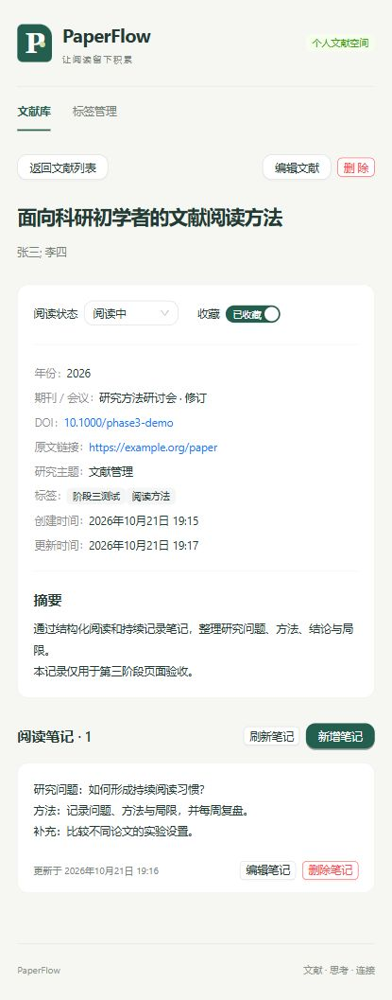

# 第三阶段验收记录

验收日期：2026-10-21。范围依据 `prompt/第三阶段.txt`。本阶段完成后停止。

## 完成内容

| 页面 / 功能 | 实现 |
| --- | --- |
| 文献列表 | 标题、作者、年份、标签、阅读状态、更新时间、收藏标记；详情入口、编辑、删除、20 条分页 |
| 新增文献 | 完整可写字段、多标签选择、必填 / 年份 / 外链校验，保存后进入详情 |
| 编辑文献 | 回填当前字段与关联，PATCH 保存，失败保留输入 |
| 文献详情 | 展示完整文献信息、摘要和时间；直接修改阅读状态与收藏 |
| 标签管理 | 创建、重复提示、关联文献数、删除确认 |
| 阅读笔记 | 详情内独立模块；新增、编辑、删除、多行文本、非空校验 |

公共行为包括加载骨架 / 表格加载、空状态、错误提示与重试、404 返回入口、写入期间防止重复提交、删除确认。使用 Hash 路由支持刷新与直接链接，页面按需加载；窄屏表格横向滚动。页面切换后回到顶部。

没有新增 Dashboard、搜索筛选、AI 或 ECharts 页面；没有修改后端代码、接口、表结构和已有正式数据。

## 文件变更

- `frontend/src/App.tsx`、`components/AppShell.tsx`：页面入口、导航和 Ant Design 消息上下文。
- `frontend/src/pages/PageRouter.tsx`、`routing.ts`：懒加载和 Hash 路由。
- `frontend/src/pages/PaperListPage.tsx`、`PaperFormPage.tsx`、`PaperDetailPage.tsx`、`TagsPage.tsx`：核心业务页面。
- `frontend/src/components/PaperForm.tsx`：新增 / 编辑共享表单。
- `frontend/src/components/NotesPanel.tsx`、`NoteEditor.tsx`：笔记列表与编辑器。
- `frontend/src/components/DeletePaperButton.tsx`、`LoadError.tsx`、`ReadingStatusTag.tsx`：删除确认、错误处理、状态展示。
- `frontend/src/api/client.ts`、`types/api.ts`：统一请求和业务类型，支持 JSON 写入、204、取消、超时与后端错误详情。
- `frontend/src/hooks/useResource.ts`、`utils/papers.ts`：请求生命周期、格式化与安全外链。
- `frontend/src/styles.css`：沿用原应用壳，补充表单、详情、笔记和窄屏布局。
- `frontend/vite.config.ts`：独立联调代理配置、React 公共分包。
- `frontend/package.json`、`tests/client.test.mjs`、`tests/navigation.test.mjs`：Node 内置测试，无新增依赖。
- `README.md`、`docs/design.md`、本记录及 `docs/screenshots/phase-3-detail.jpg`：同步进度、操作指南与验收证据。

第一阶段 `OverviewPage.tsx` 仍保留在源文件中，本阶段没有路由入口，不会在当前页面请求 Dashboard。

## API 对接结果

直接使用既有 `/api/papers`、`/api/tags`、`/api/papers/{id}/notes` 和 `/api/notes/{id}` 接口，无需调整后端。

- 列表消费 `items / total / pages`，每页 20 条；详情和 PATCH 响应直接更新展示。
- 状态使用 `not_started / reading / completed`，标签关联提交 `tag_ids`。
- 统一解析 `{data: ...}`；删除的 204 空响应不进行 JSON 解析。
- 后端 409 重复标题 / DOI 错误可映射到表单字段；其他错误显示可读提示。
- 文献保存仅提交可写字段，笔记更新仅提交 `content`。

本次已验收流程中未发现未解决的接口对接问题。

## 自动检查

| 检查 | 结果 |
| --- | --- |
| 后端 `.venv` Python 3.12：`python -m pytest -q` | 95 passed；有 1 条 pytest 缓存目录权限警告，不影响测试通过 |
| 前端 `npm.cmd test` | 15 passed，0 failed |
| 前端 `npm.cmd run build` | TypeScript 检查及 Vite 生产构建通过，无分包体积警告 |

前端测试验证 JSON 数据保真、204 响应、409 错误字段、网络异常、非 JSON 错误、非法成功响应、请求取消、笔记归属路径、路由 ID 与 HTTP(S) 外链。前端单元测试使用模拟请求；真实交互另以浏览器验收。

## 浏览器验收

使用本机内置浏览器、前端 5174 与后端 5001，数据库为独立的 `backend/instance/phase3-ui-verification.db`，不向正式库插入测试记录。

1. 空文献列表正常；标签空输入显示必填提示；创建两个标签成功，重复标签显示“标签已存在”且保留输入。
2. 文献空提交显示标题 / 作者必填；年份 999 被拒绝。完整填写字段、选择两个标签，保存后正确显示详情。
3. 在详情将状态改为“阅读中”、开启收藏；编辑页正确回填全部字段，修改期刊后保存成功，刷新仍保留状态和收藏。
4. 空笔记被拒绝；新增多行笔记、编辑补充、删除后计数和空状态同步更新。
5. 两个标签的关联数显示 1；删除其中一个已关联标签后，文献仍保留，列表只显示剩余标签。
6. 重复标题保存显示后端错误及标题字段错误；原输入保留。
7. 取消文献删除保留记录；确认删除后列表为空。直接打开已删除详情显示“内容不存在或已被删除”及重试 / 返回入口。
8. 在独立库准备 21 条分页数据；第二页仅 1 条，删除该条后自动返回第一页面的 20 条，分页控件按单页规则隐藏。
9. 实际查看宽屏详情和约 511px 窄屏列表：内容正常排版，窄屏列表通过表格内部滚动查看其余列。

验收中修复了 Ant Design 6 `Modal.maskClosable` 弃用提示（改为 `mask.closable`），重新打开弹窗没有新增该警告；并修复跨页面导航保留旧滚动位置的问题。最终构建和前端测试已在修复后重新通过。

浏览器验收为本机手动自动化操作记录，并非新增的端到端测试套件。未执行生产部署或跨浏览器矩阵测试。

验收后已停止 5001 / 5174 测试服务，并通过项目启动脚本恢复 5000 / 5173 默认服务；浏览器确认正式库文献列表正常加载。测试数据库留在已忽略的 instance 目录，截图中的演示记录不会出现在正式文献库。
