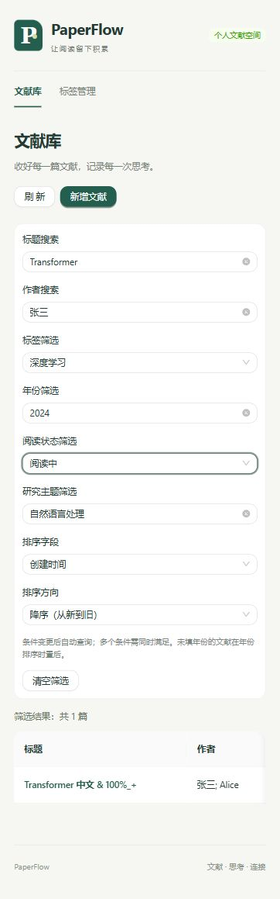

# 第四阶段验收记录

本阶段完成文献检索、组合筛选、排序及分页验证。

## 完成内容

- 在原文献列表加入标题、作者搜索，以及标签、年份、阅读状态、研究主题筛选。
- 支持多条件 AND 组合；标题和作者采用字面子串匹配，主题按完整名称精确匹配。
- 按年份、创建时间、更新时间升降序排序；默认创建时间降序，空年份始终置后。
- 连续输入合并为约 300 毫秒后查询；条件与页码一起更新，避免用旧页码请求新条件。翻页保留查询条件，旧请求会被取消。
- 清空全部条件时同步恢复默认排序与第一页；单字段可单独清空。
- 显示结果总数、加载状态和友好无结果提示。非法年份显示原因并保留上次有效查询；标签加载失败提供独立重试。
- 沿用原页面结构和 Ant Design 组件，补充筛选栏响应式布局，未增加依赖。

没有开发 Dashboard、AI 或进行大规模 UI 重构。筛选状态仅属于当前列表页面，离开该页面或刷新浏览器会恢复默认条件。

## 文件变更

| 文件 | 用途 |
| --- | --- |
| `frontend/src/components/PaperFilterBar.tsx` | 新增独立筛选栏，加载真实标签，年份提示与标签失败重试 |
| `frontend/src/pages/PaperListPage.tsx` | 条件状态、延迟查询、分页联动、清空、结果计数及空状态 |
| `frontend/src/utils/paperFilters.ts` | 条件规范化、默认排序、年份校验与是否存在筛选条件 |
| `frontend/src/types/api.ts` | 查询条件与排序字段类型 |
| `frontend/src/api/client.ts` | URLSearchParams 查询编码，沿用统一请求封装 |
| `frontend/src/styles.css` | 筛选栏网格及窄屏布局 |
| `frontend/tests/client.test.mjs`、`filters.test.mjs` | 组合参数、特殊字符、清空、年份和空状态条件检查 |
| `backend/tests/test_stage4_search.py` | 16 项基于真实 SQLite 的本阶段接口验收 |
| `README.md`、`docs/design.md` | 当前进度、第四阶段表、使用说明、测试结果同步 |
| 本文件、`docs/screenshots/phase-4-filters.jpg` | 验收记录与截图 |

## 接口变化

**后端接口无变化，后端业务代码和数据库结构无变化。** 既有 `GET /api/papers` 已覆盖全部要求。前端列表请求使用 `page`、`page_size=20`、`title`、`author`、`tag_id`、`year`、`reading_status`、`research_topic`、`sort_by` 和 `sort_order`；空条件不发送，特殊字符正确编码。标签选项使用既有 `GET /api/tags`。

前端 API 方法保留原 `list(page, signal)` 用法，在第三个可选参数接收筛选对象。数据总数、分页与排序均由服务端数据库查询返回，未在当前页本地过滤。本次未发现未解决的接口对接问题。

## 自动检查

| 检查 | 结果 |
| --- | --- |
| `npm.cmd test` | 20 passed，0 failed；新增 5 项 |
| `npm.cmd run build` | TypeScript 与 Vite 生产构建通过 |
| `python -m pytest -q -p no:cacheprovider --tb=short -x` | 111 passed；原 95 项及新增 16 项全部通过 |

新增数据库测试每例使用独立 SQLite 文件，覆盖各单条件、六条件交集、多标签不重复计数、无结果、清空、特殊字符、筛选分页以及三种字段双方向排序。时间戳在测试内明确设定，保证排序检查可重复；年份排序包含相同年份与空年份。

初次后端测试受沙箱临时目录权限限制而无法创建测试库；获准在沙箱外重跑后全部通过。前端类型检查发现标签错误状态为 unknown，已改为明确布尔条件后通过构建。未通过修改权限或业务代码绕过测试问题。

## 浏览器验收

使用内置浏览器、前端 5174、后端 5001、独立数据库 `backend/instance/phase4-ui-verification.db`。准备 26 条文献，包含 22 条分页记录、不同作者 / 状态 / 标签 / 主题、2020 / 2022 / 2024 / 空年份及确定的创建 / 更新时间。正式数据库未写入验收数据。

| 场景 | 实测结果 |
| --- | --- |
| 标题搜索 | `Transformer` 返回 2 篇；从原列表第二页输入后正常回到第一页 |
| 作者搜索 | `张三` 单独返回 2 篇；与 Transformer 组合返回 1 篇 |
| 标签筛选 | 深度学习返回 2 篇 |
| 年份筛选 | 2022 返回 1 篇；999 显示错误，保留上次有效结果 |
| 阅读状态 | 已读完返回 1 篇 |
| 研究主题 | 自然语言处理返回 3 篇；不完整名称自然语言返回 0 篇 |
| 全部条件组合 | 标题 Transformer、作者张三、深度学习、2024、阅读中、自然语言处理同时匹配 1 篇 |
| 无结果 | 将上述作者改为 Bob 返回 0 篇，显示调整 / 清空筛选提示 |
| 特殊字符 | 标题 `& 100%_+` 正确返回唯一记录 |
| 年份排序 | 升序为 2022、2024、空；降序为 2024、2022、空 |
| 时间排序 | 创建与更新时间各自升降序均与测试库时间一致 |
| 筛选后翻页 | 标题分页验收返回 22 篇，第二页为 2 篇且保留标题条件 |
| 清空筛选 | 清空控件、恢复创建时间降序、回第一页，显示全部 26 篇 |
| 连续输入后立即清空 | 已排队的条件不再覆盖清空结果，仍显示全部 26 篇 |
| 页面与控制台 | 当前窄屏下筛选栏纵向排列、表格可横向滚动；控制台无 error / warn |

浏览器检查是本机交互验收记录，未新增端到端测试框架，未进行跨浏览器矩阵或生产部署。

验收后已停止 5001 / 5174 测试服务，通过项目脚本启动默认 5000 / 5173 服务；浏览器确认正式库正常加载筛选栏和空列表。验收数据保留在已忽略的独立测试数据库中，未写入正式库。
