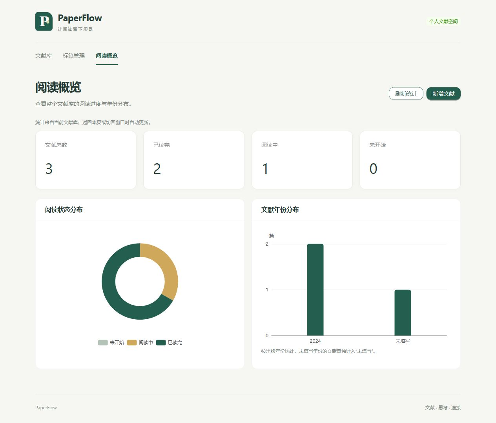

# 第五阶段验收记录

验收日期：2026-10-23（Asia/Shanghai）。依据 `prompt/第五阶段.txt` 完成 Dashboard 和统计可视化，本阶段结束后停止开发。

## 完成内容

- 新增导航“阅读概览”和 `/#/dashboard` 路由，默认首页保持为文献库。
- 展示文献总数、已读完、阅读中、未开始四项统计。
- 使用 ECharts 绘制阅读状态环形图、出版年份柱状图。空年份归入“未填写”，纵轴为整数篇数。
- 统计来自整个数据库，不受列表筛选、分页、标签或笔记数量影响。
- 返回页面自动重新查询；恢复窗口焦点或页面可见性、点击“刷新统计”也会重新查询。没有轮询或推送；通过外部 API 修改且页面持续保持焦点时，需要手动刷新。
- 加载提示、首次加载骨架屏、空库引导、接口异常与重试；失败时不展示旧统计作为当前结果。
- 图表数据整体替换，移除已消失的年份；观察容器尺寸并自动调整，离开页面销毁图表实例和监听器。
- 沿用现有绿色主题与 Ant Design 样式，图表在窄屏下纵向排列。

未增加标签 TOP10 等可选统计，未开发 AI，未进行无关重构，未新增依赖。

## 修改文件

| 文件 | 用途 |
| --- | --- |
| `frontend/src/pages/OverviewPage.tsx` | 替换早期占位页，统计卡片、刷新和加载 / 空 / 错误状态 |
| `frontend/src/components/DashboardCharts.tsx` | ECharts 按需注册、两种图表、尺寸自适应和销毁 |
| `frontend/src/utils/dashboard.ts` | API 聚合值映射为图表数据，空年份中文标签 |
| `frontend/src/routing.ts`、`frontend/src/pages/PageRouter.tsx` | 概览 Hash 路由与懒加载 |
| `frontend/src/components/AppShell.tsx` | 阅读概览入口及导航选中状态 |
| `frontend/src/styles.css` | 图表网格、高度与窄屏布局 |
| `frontend/tests/dashboard.test.mjs`、`frontend/tests/navigation.test.mjs` | 图表数据映射、零值、分类移除、概览路由 |
| `backend/tests/test_stage5_dashboard.py` | 4 项真实 SQLite 统计验收 |
| `README.md`、`docs/design.md`、本文件 | 使用说明、接口与验收结果 |
| `docs/screenshots/phase-5-dashboard.png` | 独立测试库 Dashboard 截图 |

## 统计接口

复用 **`GET /api/dashboard`**，没有新增或修改后端业务接口、数据库表结构。

响应为 `{ "data": { ... } }`，本页使用：

| 字段 | 说明 |
| --- | --- |
| `total` | 全部文献数 |
| `completed`、`reading`、`not_started` | 三种阅读状态数量 |
| `by_status` | `{ status, count }[]`，空库也包含三种零值状态 |
| `by_year` | `{ year, count }[]`，年份升序，`null` 最后 |

现有 `favorites`、`by_tag` 字段保持兼容，页面不展示。所有值由数据库实时聚合，不缓存，不写死演示数值。

## 自动测试

| 检查 | 结果 |
| --- | --- |
| 后端 `python -m pytest -q -p no:cacheprovider --tb=short -x` | **115 passed**，新增 4 项 |
| 前端 `npm.cmd test` | **22 passed**，新增 2 项，补充概览路由断言 |
| `npm.cmd run build` | TypeScript 类型检查与 Vite 生产构建通过 |

后端新增测试覆盖空库、三种状态、多标签多笔记不放大计数、重复年份与空年份、25 篇超过一页、创建 / 三种状态切换 / 年份修改 / 删除后的统计同步，并逐项核对状态与年份合计等于总数。测试使用独立临时 SQLite 数据库。沙箱临时目录权限阻止首次执行，经授权在沙箱外重跑完成全部测试。

前端验证实际数量、零值状态、空年份、不残留已消失分类和路由。生产构建有概览页面分块超过 500 kB 的非阻断提醒（约 543 kB，gzip 187 kB）；已采用按需 ECharts 模块和路由懒加载，没有调整警告阈值。

## 浏览器验收

使用内置浏览器、前端 5174、后端 5001，独立数据库 `backend/instance/phase5-ui-verification.db`。本次测试创建的全部数据仅写入该库。沙箱内服务无法被浏览器连接，经授权改在沙箱外启动仅监听本机的验收服务。

| 场景 | 实测结果 |
| --- | --- |
| 空库 | 四项统计为 0，显示“还没有文献”和新增入口，无虚构图表 |
| 初始三篇 | 总数 3，三状态各 1；年份 2020 / 2024 / 未填写各 1 |
| 页面新增 | 从概览新增 2024 年文献，返回概览自动变为总数 4、未开始 2、2024 年 2 |
| 页面修改状态 | 将新文献改为已读完，返回概览显示已读完 2、未开始 1，环形图同步 |
| 删除文献 | 通过真实 API 删除测试库唯一 2020 年文献，点击刷新后总数 3、未开始 0，年份图移除 2020 分类 |
| 异常提示 | 停止测试后端后刷新，显示加载失败、服务不可用及重试入口，隐藏旧统计 |
| 重试恢复 | 恢复测试后端，点击重试后卡片和两种图表恢复正确数据 |
| 窄屏 | 实测内容区宽 387 CSS px，图表单列，SVG 宽度与容器一致，无横向溢出；沿用原页面最低宽度 320 px |
| 控制台 | 正常新增 / 修改 / 刷新过程中没有 warn / error；断开后端测试产生预期网络失败 |

浏览器检查为本机交互验收，未引入端到端测试框架或进行跨浏览器测试。窗口焦点与可见性刷新逻辑已实现，但未单独执行跨窗口写入场景。正式数据库未写入验收数据。收尾检查时 5001 / 5174 已无监听服务，截图与独立测试库保留。
