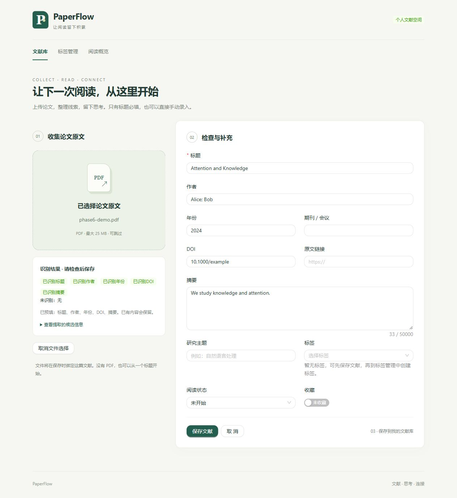
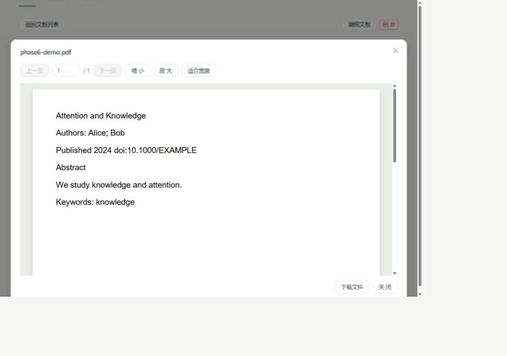
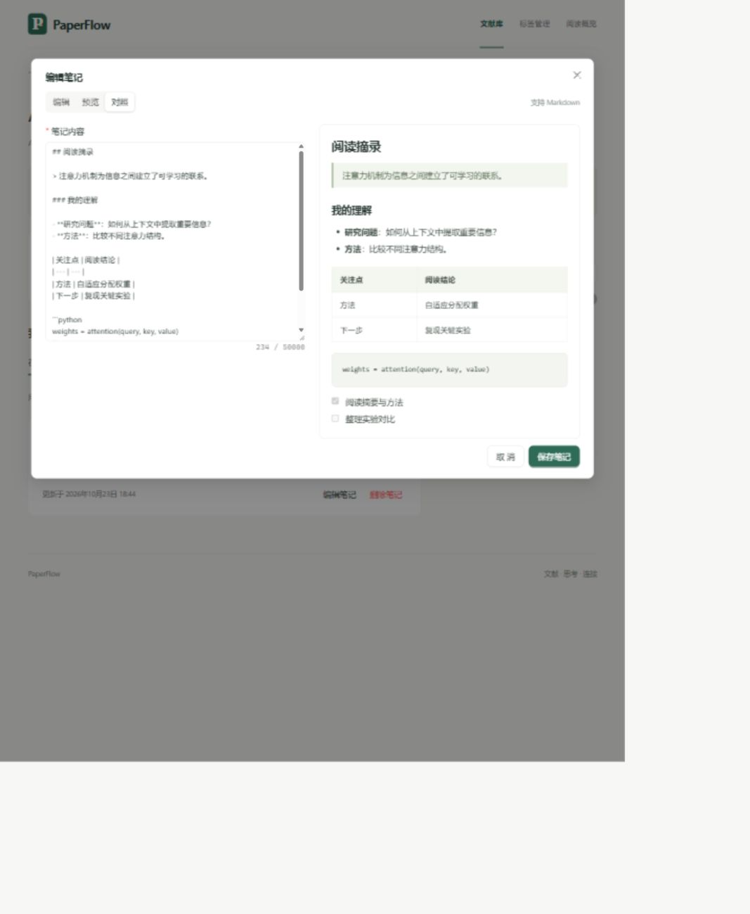
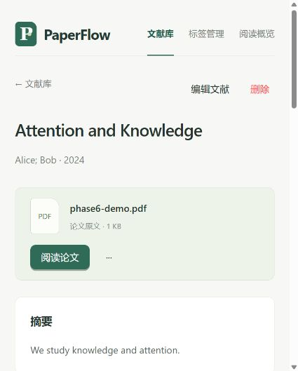
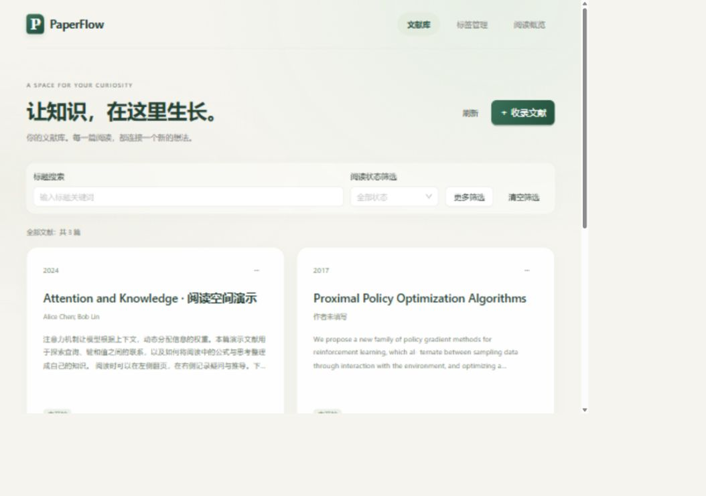
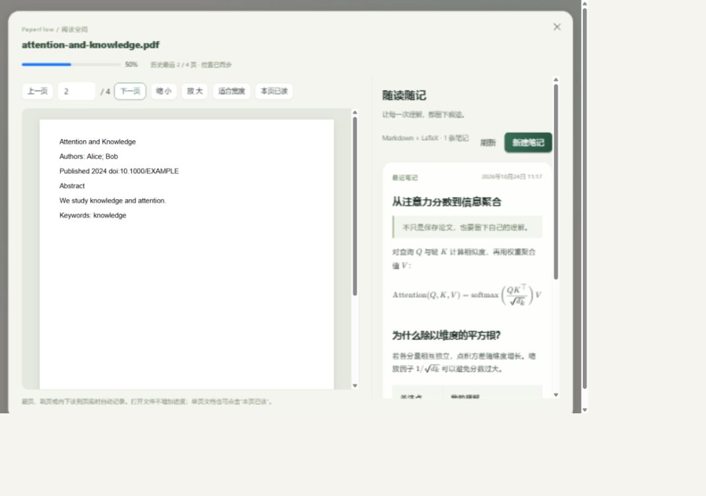
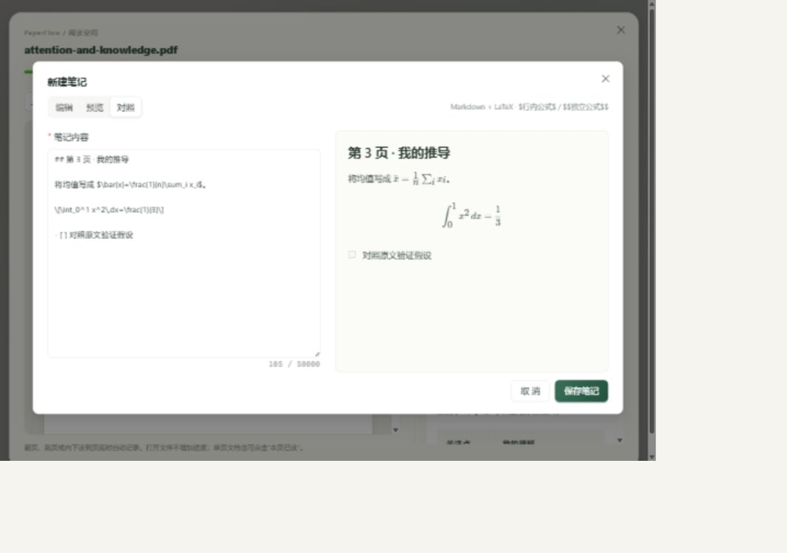
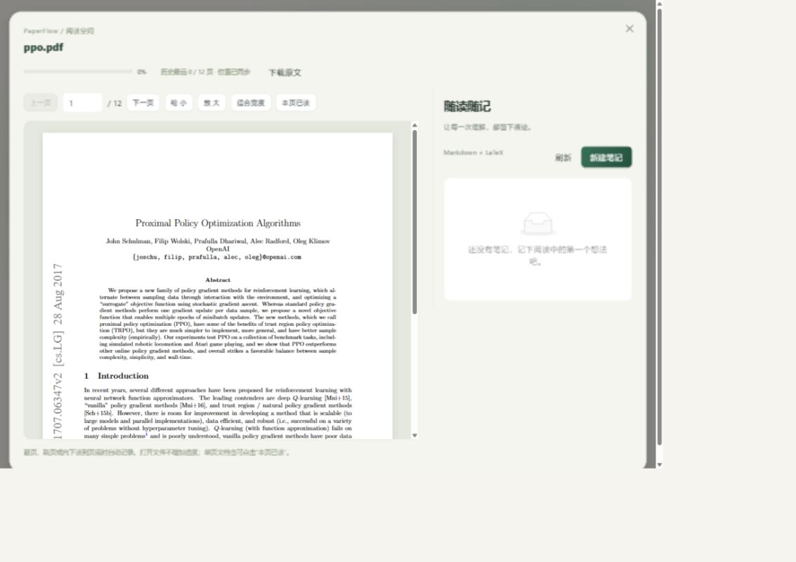
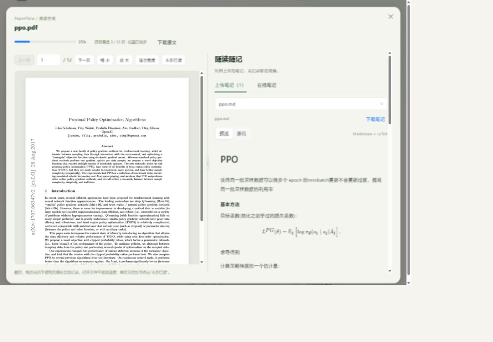

# 第六阶段验收记录

依据 `prompt/第六阶段.txt` 和反馈完成文件管理、本地 PDF 信息提取、笔记附件、Markdown / LaTeX、阅读进度及 UI，本阶段结束后停止。

## 完成内容

- 新增 / 编辑文献可选 PDF；只有标题必填，作者、年份、期刊 / 会议、DOI、摘要、研究主题等选填。
- PDF 先上传到无状态解析接口，展示识别结果并预填空字段，保留用户已有内容。点击保存才绑定文献并落盘，取消不产生孤儿上传。
- 论文原文支持阅读、下载、替换和删除。替换前确认；文献与 PDF 一起提交，失败回滚。
- 保留多条在线文本笔记，增加多个 PDF / DOCX / MD / TXT 附件；详情页分开展示原文、元信息、摘要、标签和状态、在线笔记、上传的笔记附件。
- PDF 使用 PDF.js 单页画布阅读器，支持翻页、页码、缩放、适合宽度。MD 渲染 Markdown 并可查看源码，TXT 以纯文本预览；DOCX 下载后本地打开。
- 扩展名 / MIME / 基本内容校验、25 MB 上限、空文件和 UTF-8 校验、文件缺失、读写失败、网络失败、数据库失败提示。删除文献时处理全部关联文件、笔记和标签关系。
- SQLite 幂等升级移除旧作者非空约束，保留已有记录、ID、索引和关联，新增附件表。上传目录忽略提交，数据库只存相对路径。
- 原文献 CRUD、去重、标签、阅读状态、收藏、搜索、筛选、排序、分页及 Dashboard 继续通过回归。

## 自动化检查

| 检查 | 结果 |
| --- | --- |
| 后端 `python -m pytest -q -p no:cacheprovider --basetemp=instance/phase6-reading-final-tests` | **158 passed**；本阶段新增 43 项 |
| 前端 `npm.cmd test` | **34 passed**；本阶段新增 12 项 |
| `npm.cmd run build` | TypeScript 与 Vite 生产构建通过 |

后端测试使用独立 SQLite 文件与上传目录。最初普通运行受 Windows 临时目录 / 沙箱本机 socket 权限限制，随后使用工作区临时目录并在允许访问本机端口的环境完成全套测试。没有跳过真实 HTTP 测试。

新增测试覆盖：只填标题 / 空作者、五字段识别、无 metadata 的文本回退、空白 / 加密 / 异常 PDF、解析不持久化、查看和下载响应、替换和文献级联删除、单文件删除、多笔记、非法扩展名 / MIME / 内容、空文件、超限、缺失文件、重复文献不残留文件、创建 / 替换 / 删除数据库失败恢复、文件占用失败、异常退出存储恢复、DOCX / 纯文本响应安全头、旧库迁移保持标签和笔记、解析超时回退。

旧测试将作者空值改为有效输入，并继续检查作者非法类型；标题非空、年份和 DOI 等原校验仍保留。前端新增检查 multipart 正文和 boundary、解析与笔记归属路径、Blob 和文件错误、204 删除响应。

构建仍有 Dashboard 分块约 543 kB 的非阻断提示。新增 PDF 阅读模块约 439 kB，worker 约 1.26 MB，按需加载；字体、CMap 和解码器由构建脚本从依赖复制到本地静态资源，不请求 CDN。新增后端依赖 pypdf 6.21.2、前端 pdfjs-dist 6.4.299，锁文件已更新。

## 浏览器验收

使用本机前端 5174、后端 5001，独立测试库 `backend/instance/phase6-ui.db` 与独立目录 `backend/instance/phase6-ui-uploads`。上传文件是测试代码生成的 PDF 和 Markdown，不使用个人文献。

| 场景 | 结果 |
| --- | --- |
| PDF 上传与预填 | 识别标题、作者、2024 年、DOI、摘要，显示五个识别标签；表单预填后等待用户保存 |
| 保存文献 | 保存成功进入详情，显示绑定的 PDF 与文献信息 |
| PDF 阅读 | 最初发现原生 iframe 阅读器空白，改为 PDF.js 后在窄屏与桌面布局均实际显示正文 |
| 在线笔记 | 从“新建笔记”创建中文多行笔记，保存成功且列表数量更新 |
| Markdown 附件 | 从“上传笔记”选择 Markdown，成功绑定到当前文献 |

## 边界与使用说明

- PDF 解析是启发式候选，不保证标题换行、作者、年份或摘要边界完全准确。优先 metadata，再取前两页文本与正则；出版年份需由用户核对。不使用 AI 或 OCR，扫描件 / 加密 / 解析异常时可手动补充。解析子进程上限 12 秒，超时不阻断原文件保存。
- DOCX 首版下载后使用本地阅读器查看；MD 渲染标题、表格、代码和任务清单，原始 HTML 转义显示，不执行脚本。PDF 画布首版不提供全文搜索、文本选中或批注；加密或损坏文件保留下载入口。
- 上传校验验证文件类型和基本结构，不保证损坏文档可成功阅读。完整原文件会保留，以便下载和替换。
- 文件与数据库通过隔离、回滚和启动恢复保持一致。删除提交后若操作系统暂时阻止清理，隔离文件不会经 API 暴露，日志记录后在下次 `init-db` 重试。该命令只能在服务停止时执行；备份必须同时包含数据库与 uploads。
- 浏览器实测为本机检查，不代表跨浏览器完整覆盖；其余非法输入、失败回滚、替换 / 删除等边界由自动化测试验证。
- 本阶段没有接入 AI，也没有开展第七阶段。

## Markdown 与 UI 反馈修正

- MD 附件默认为渲染预览，支持源码切换；在线笔记也按 Markdown 显示，编辑器提供编辑 / 预览 / 对照模式。
- 收紧导航和标题区域，去掉重复的英文装饰标题和流程编号；详情以阅读、摘要和笔记为主，管理信息在侧栏，收录时间折叠；在线笔记与附件通过页签切换。
- 原文下载 / 替换 / 删除和附件下载 / 删除收进更多菜单。文献库合并标题、作者与年份，默认收起高级筛选，保留全部筛选能力。
- 新增 4 项 Markdown 实际组件渲染测试，覆盖标题 / 引用 / 列表 / 代码块、GFM 表格 / 任务清单 / 删除线、危险 HTML / URL 和普通文本兼容。前端合计 30 项通过，生产构建通过。
- 浏览器实测现有 MD 附件由标题语法变为真正的标题，切换源码保留原文；在线笔记对照模式实时显示中文引用、表格、代码块、勾选清单，保存后列表显示排版结果。
- 窄屏检查修复代码块撑宽笔记卡片的问题；在 325 CSS px 视口下页面内容宽度为 320 px，无横向溢出，长代码在卡片内滚动。
- 本机正式库升级前保存为 `backend/instance/paperflow-before-stage6.db`；升级后逐表比对 papers、notes、tags、paper_tags 一致，外键检查通过。独立 UI 验收服务保持在 5001 / 5174，供查看更新后的效果。

## 公式、自动进度与阅读空间

- 在线笔记、对照编辑和 MD 附件共用 Markdown + KaTeX，支持行内 / 块级公式、分式、根号、求和与积分；反斜杠括号分隔符可渲染，源码切换及下载保留原内容。
- 浏览器验证独立 4 页演示 PDF：首次打开为 0%；翻到第 2 页保存 50%，详情自动为阅读中；跳到第 4 页为 100%，回看第 3 页仍为已读完；关闭后重开实际恢复第 3 页。
- 在阅读空间内新建含行内均值与块级积分的笔记，对照模式正确排版，保存后出现在右侧最近笔记；关闭阅读空间后详情同步显示。
- 358 CSS px 视口下阅读器与笔记上下排列，页面无横向溢出；恢复默认视口。双栏 PDF / 笔记与文献卡片见下方截图。
- 新增后端 16 项测试涵盖打开不计进度、回看不倒退、完成状态保持、单页文档、长文档百分比边界、非法页码、页数冲突、附件类型限制、替换 / 删除级联及幂等升级。原 Dashboard 回归同步改为完成状态保持规则。
- 前端新增 3 项公式实际组件测试及 1 项阅读进度请求测试，覆盖不同公式分隔符、代码保留、危险 LaTeX 命令和 false / true 阅读事件。
- PDF 预览反馈复查：发现本机预览服务停止导致动态模块加载失败、页面空白；恢复服务后，演示 PDF 和用户已上传的 2.8 MB、12 页 PPO PDF 均实际显示正文。后者仅打开验证，仍保持 0% 与未开始。
- 补充页面 / 阅读器错误边界、加载和单页渲染 30 秒超时、重试预览及下载原文入口。真实加密或损坏文件不伪装为成功预览。

## 上传笔记对照阅读与拖动宽度

- 修复阅读空间右侧仅显示在线笔记的问题，新增“上传笔记”页签和附件选择器。有附件时默认显示上传笔记，MD / LaTeX、PDF、TXT 内嵌显示，DOCX 延续本地打开限制。
- 使用已上传的 `ppo.pdf` / `ppo.md` 实测：左右同时显示正文和公式；在线笔记仍可进入新建入口，Markdown 源码 / 预览切换正常。
- 鼠标拖动分隔条，将笔记区域从约 36% 调整至 48%；关闭阅读窗口后重开保持 48%。键盘方向键也能调整宽度。整个过程原文保持第 1 页、历史进度 25%，没有因切换笔记或调整宽度增加进度。
- 366 CSS px 视口下自动改为上下布局、隐藏分隔条，页面滚动宽度等于视口宽度，无页面横向溢出。
- 前端 35 项测试通过，新增文件请求取消回归；TypeScript 检查与生产构建通过。此次未修改后端，后端 158 项通过为上一轮验收结果。

