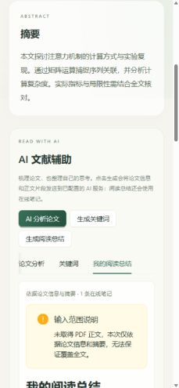
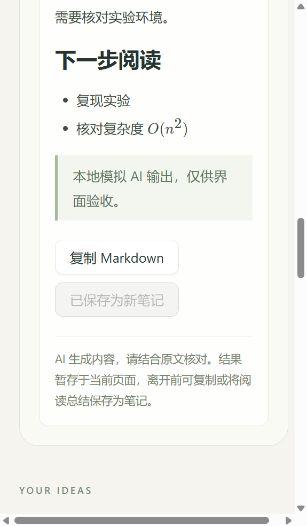
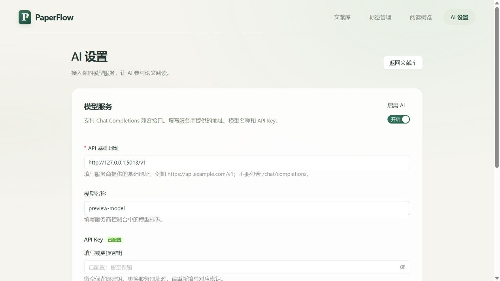

# 第七阶段验收记录

日期：2026-10-25。

## 实现与边界

- `AIService` 仅负责配置、提示词、Chat Completions HTTP 调用和响应校验；`ai_context.py` 构造有界输入，路由处理资源查找与用户确认后的写入。
- 独立 AI 区域提供论文分析、关键词、阅读总结三项操作。分析固定包含研究问题、核心方法、主要贡献、实验与结果、局限性、值得重点阅读的内容；复用 MarkdownView / KaTeX 展示。
- 生成接口不修改数据库。关键词先展示，用户勾选后通过独立接口原子合并，复用同名标签并保留原关联；重复确认不会创建重复标签。总结可以复制或通过既有笔记接口新增，保存后刷新笔记列表并禁用重复保存按钮。
- API Key 支持网页填写并保存至后端；未网页保存时读取环境初始值。设置响应不包含密钥，`.env` 与 `instance` 被 Git 忽略；示例文件没有真实密钥。AI 默认关闭，配置错误延迟到 AI 操作时处理，不阻塞应用启动或普通文献管理。
- 未启用、未配置、缺少正文、上游认证失败、限流、连接异常、超时、空或畸形响应、输出截断均有中文提示。上游原始错误和密钥不回传；不自动重试。禁止自动跟随上游重定向，防止转发认证头。

## 接口

| 方法与路径 | 输入 / 输出 |
| --- | --- |
| `GET /api/ai/status` | `available`、`message`；仅检查本地配置 |
| `POST /api/papers/:id/ai/analysis` | 不需请求体；返回六项分析 `markdown` 和 `source` |
| `POST /api/papers/:id/ai/keywords` | 不需请求体；返回 3～8 个 `keywords` 和 `source` |
| `POST /api/papers/:id/ai/reading-summary` | 不需请求体；返回总结 `markdown` 和 `source` |
| `POST /api/papers/:id/ai/keywords/apply` | `{"keywords":["所选词"]}`；返回文献详情 |

保存总结复用 `POST /api/papers/:id/notes`。不存在的文献返回 404。AI 错误不影响 CRUD、附件、笔记与 Dashboard。

## 实际输入

- 论文信息：标题、作者、年份、来源、DOI、研究主题，以及最多 6000 字符摘要。
- 论文正文：复用 pypdf 独立进程，最长解析 12 秒；最多 24 页均匀抽样，包含首尾页，正文总量不超过 24000 字符，标注页码。
- 无法读取、加密、扫描件或解析超时时，存在摘要则明确提示只使用摘要；无摘要则返回 `AI_NO_CONTENT`，不发送模型请求。
- 阅读总结额外使用最新 20 条在线笔记，平分 8000 字符预算；用户修改笔记后再次生成会读取最新内容。无笔记、笔记截断和未解析附件均明确提示。
- 页面显示输入来源、页数、字符数、笔记数和范围说明。输出仅在当前页面暂存，用户可复制或保存总结。

配置步骤及参数范围见 [README](../README.md#第七阶段-ai-配置与接口) 和 [配置示例](../backend/.env.example)。请求协议依据 [OpenAI Docs：Chat Completions](https://developers.openai.com/api/reference/resources/chat)；地址、模型、输出 token 参数均可切换。

## 自动验证

- 后端：`..\.venv\Scripts\python.exe -m pytest -q --tb=short`，**195 passed**，其中第七阶段新增 **37 项**。
- 前端：`npm.cmd test`，**39 passed**，新增 **4 项** AI 请求路径、超时隔离、关键词提交和请求取消测试。
- `npm.cmd run typecheck`、`npm.cmd run build` 通过。
- 测试覆盖真实 PDF 解析与页数截取、超时回退、无内容阻断、长摘要 / 笔记上限、当前笔记输入、六字段结构、关键词格式 / 去重 / 原子校验、显式新建笔记、不修改原数据、配置关闭与各类上游异常。
- 原有文献、标签、笔记、文件、搜索、统计、阅读进度与 Markdown / LaTeX 安全性测试均回归通过。
- 初次测试中的超长参数名触发 Windows 临时路径问题，已使用简短测试 ID 修复；复跑全量通过。
- 非阻断提醒：pytest 缓存目录写权限警告（不影响测试结果）；已有图表 chunk 大于 500 kB 的构建提醒。

## 浏览器验收

使用独立 SQLite / 上传目录，以及本地 HTTP 模拟 AI 服务；未访问真实模型服务、未使用真实密钥或修改正式数据库。

- 点击分析后，三个生成按钮均禁用并显示 loading，完成后恢复；六项内容及 LaTeX 可见。
- 摘要回退的输入范围提示可见。
- 关键词初始均不勾选，添加按钮禁用；选两个并确认后只添加两个，页面标签立即刷新，已添加项禁用。
- 阅读总结显示使用 1 条在线笔记，生成后仍为 1 条笔记；保存后增为 2 条，原笔记内容保持，保存按钮禁用。
- 复制操作显示成功提示。当前浏览器桥接的剪贴板读取为空，因此未将剪贴板回读算作独立通过项。
- 检查宽屏与窄屏布局；生成按钮在窄屏换行，AI 区域可阅读。视口工具存在系统缩放差异，检查了实际 DOM 宽度与文档宽度后恢复默认视口。
- 内嵌浏览器首次导航超时，重新连接已打开的页面后完成上述检查。

## 未验证与已知范围

真实服务商认证、模型可用性、延迟、额度及分析质量需要用户填入配置后联调。本地 HTTP 模拟验收不代表真实模型效果。字符预算不是精确 token 预算；小上下文模型可能需要缩减输入。HTTP 超时是连接 / 读取等待超时，前端另有 90 秒等待上限，取消前端请求不保证上游停止计算。本阶段没有 RAG、向量数据库、多论文问答、Agent、OCR 或聊天界面。

## 网页 AI 设置补充

按用户反馈，将接入流程改为网站内操作：顶部导航及文献详情提供“AI 设置”入口，填写 API 基础地址、模型、API Key，支持测试连接、保存、启用 / 关闭、清除密钥和高级参数。

- 新增 `GET /api/ai/settings`、`PUT /api/ai/settings`、`POST /api/ai/settings/test`。写接口需要 `X-PaperFlow-Settings: 1`，限制本机来源并拒绝跨站访问；不信任客户端转发的来源 IP。
- 测试连接使用当前未保存表单，发送固定简短测试消息，不读取论文与笔记、不修改配置。仅返回通用成功提示，不回显模型原文。
- `AISettingsStore` 在后端 `instance/ai-settings.json` 原子保存设置，读取响应只含 `has_api_key`，不含密钥；保存后输入框清空。密钥留空保留，显式清除后不回退到环境密钥。更换基础地址必须重新填写密钥或明确清除。
- 保存后下一次 AI 请求立即使用新配置，独立应用实例 / 重启同样读取已保存值。配置优先级为网页保存 > 环境变量 > `.env` / 默认值；读取设置文件失败只影响 AI，不阻塞 CRUD。
- 配置文件包含明文密钥且被 Git 忽略，适用于本机个人使用。此功能没有新增账号系统，不表示可直接公开部署或多人共享。
- 新增后端设置测试 **22 项**，覆盖持久化、即时生效、密钥不回显、留空保留、显式清除、测试不保存、地址变更保护、错误输入、原子写失败、损坏配置隔离和跨站 / 非本机拒绝。
- 全量后端 `pytest -q -p no:cacheprovider --tb=short`：**217 passed**；前端 **40 passed**；类型检查与生产构建通过（保留既有图表 chunk 体积提醒）。
- 浏览器使用独立设置文件与本地模拟服务完成：填写 → 测试成功且服务仍关闭 → 保存立即启用 → 刷新后保留设置且密钥框为空 → 返回详情直接生成分析成功，无需重启后端。真实服务商仍需用户填写自己的配置后测试。

