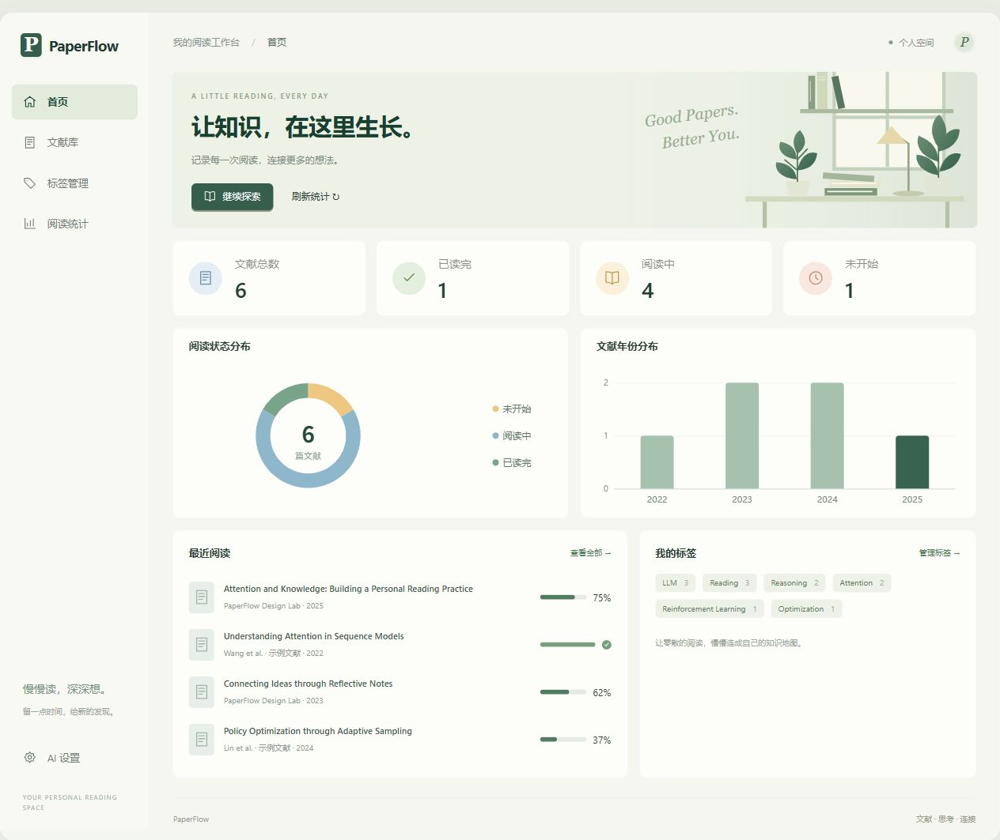
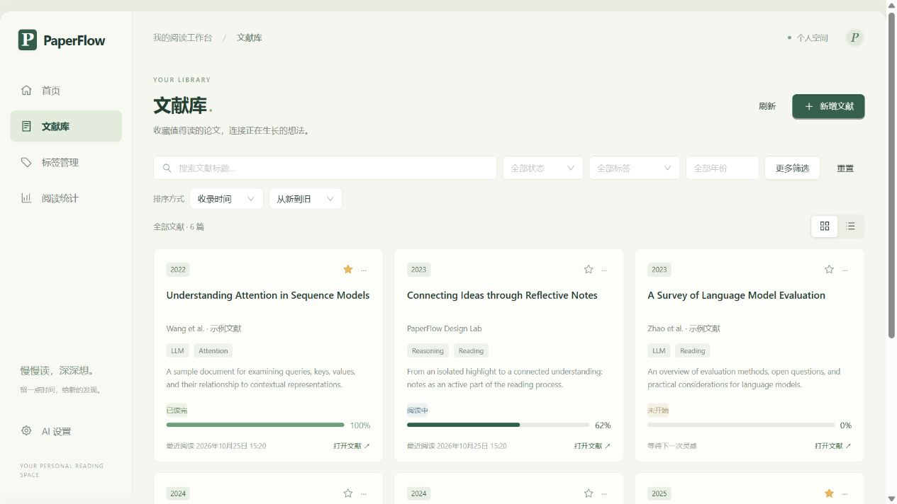
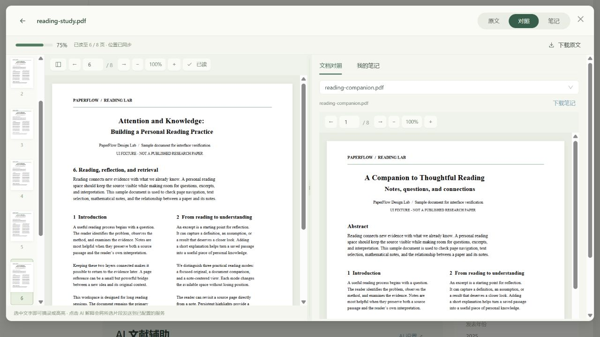
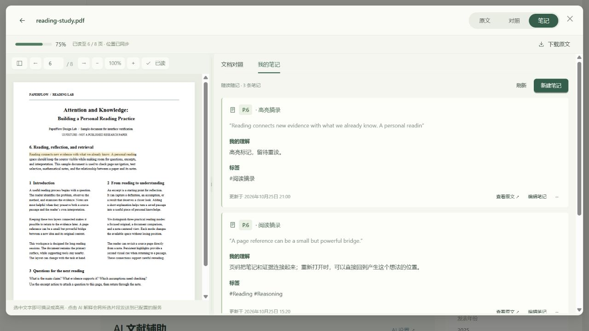
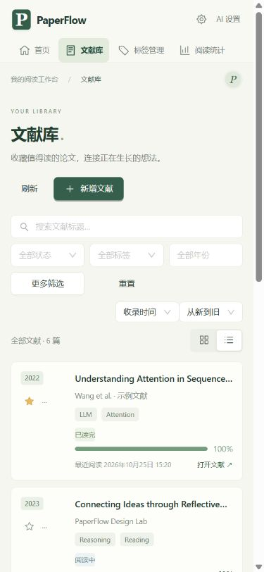
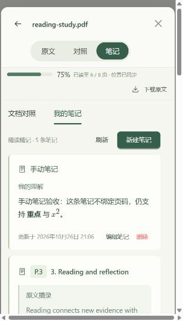
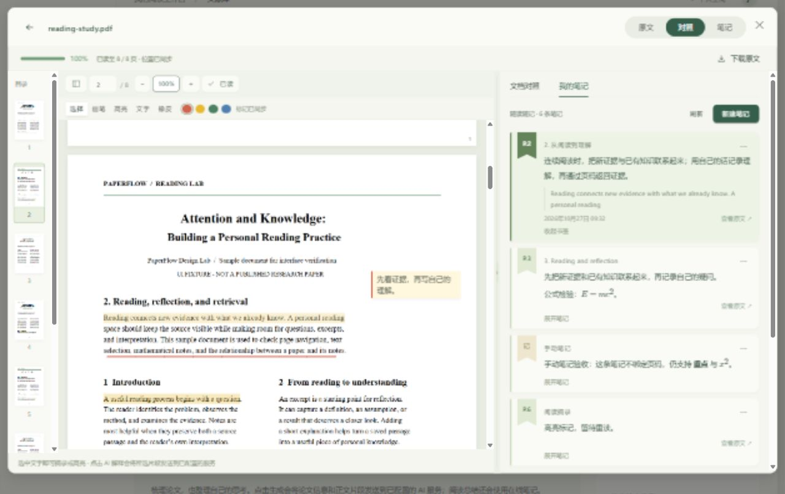

# 第八阶段界面与阅读工作台验收

本阶段以阅读工作台概念图为视觉参考，在既有功能基础上调整阅读空间和整体界面。

## 已实现

- 统一暖白背景、浅绿选中态、墨绿主按钮、线性图标、小圆角和更紧凑的留白。桌面使用左侧导航，窄屏改为顶部导航。
- 首页增加书桌插画、四项概览、阅读状态环图、年份分布、最近阅读与标签。统计及最近阅读来自数据库；最近阅读只列实际有阅读时间的原文附件。
- 首页已包含统计，导航中移除重复的“阅读统计”入口；原有统计锚点仍兼容旧链接。
- 文献库保留搜索、状态 / 标签 / 年份 / 作者 / 主题筛选及排序；提供卡片与紧凑视图并记住偏好。卡片呈现年份、收藏、作者、标签、摘要和阅读进度。
- 阅读器提供原文、对照、笔记三种布局；对照和笔记模式分别记住分栏宽度。支持拖动分隔线、键盘调整及双击重置。
- PDF 页面缩略图、分页、缩放、进度同步和附件对照保留可用。文字层支持选取片段，生成摘录或高亮笔记；高亮坐标在重新打开后恢复。
- 摘录操作在右侧“我的笔记”打开草稿卡，带入选区和页码；填写理解后才保存，不再自动保存占位笔记。卡片包含页码 / 可选章节、摘录、理解、标签、时间以及查看原文 / 编辑 / 删除操作。
- 手动新建也使用结构化卡片，不强制绑定页码或填写摘录。旧 Markdown 笔记继续使用原 Markdown / LaTeX 编辑器；旧摘录模板可直接以结构化卡片编辑。来源信息随编辑保留。
- 阅读器内和文献详情页都支持 `P.x / 查看原文`。窄屏点击页码还会将原文滚动到可见位置。草稿尚未保存时关闭阅读器会提示；同一时间的第二个摘录不会覆盖正在编辑的内容。
- 片段 AI 解释复用已有服务配置，输入限制为 8000 字符，校验原附件所属文献与页码。点击“加入我的理解”追加到当前对应摘录草稿；已有理解保留。没有草稿时创建可编辑草稿，仍需点击保存，不做聊天系统。

## 验证结果

| 验证 | 结果 |
| --- | --- |
| 后端完整测试 `python -m pytest -q -p no:cacheprovider --tb=short` | 229 项通过 |
| 前端 `npm test` | 48 项通过 |
| TypeScript 检查与 `npm run build` | 通过；保留图表分包超过 500 KB 的体积提示 |
| 桌面浏览器检查 | 首页图表、文献卡片、标题跳转、原文 / 对照 / 笔记切换正常 |
| 分栏记忆 | 笔记宽度调整到 64%，切换对照恢复此前 48%；重新打开仍保留 |
| 来源联动 | 从笔记跳转第 3 / 6 页，页码与原文同步 |
| 高亮持久化 | 选择 PDF 文字后保存高亮，关闭并重新打开仍显示高亮与对应笔记 |
| 窄屏 | 390 × 844 测试尺寸下阅读区与文献列表无横向溢出，紧凑列表可用；测试后恢复默认窗口尺寸 |
| 摘录完整闭环 | 实际拖选第 3 页文字 → 摘录到右侧草稿 → 填章节、理解、标签 → 保存 → 翻至第 5 页 → 点击 `P.3` 回到第 3 页；关闭后从详情页查看原文仍定位第 3 页 |
| AI 加入理解 | 本地测试替身经真实路由 / 服务 / 客户端返回解释；点击加入后保留用户理解，保存并重开编辑仍有追加解释与 LaTeX 公式 |
| 手动笔记 | 摘录、章节、标签留空，仅填写理解，保存后显示无页码的手动卡片；修复后端去尾空白导致空标签卡片识别失败的问题 |
| 草稿保护 | 关闭时显示未保存提示，选择继续编辑保留文字；取消编辑需确认，已保存内容保留 |
| 删除 | 浏览器确认对话框展示并取消；后端真实创建 / 更新 / 删除及旧笔记保留由集成测试验证 |

新增后端测试覆盖最近阅读顺序、片段解释输入边界、附件归属、AI 关闭与生成不写库；新增前端测试覆盖来源标记往返、编辑保留、损坏标记兼容及坐标过滤。

## 数据兼容与边界

来源信息及带版本的结构化字段存于笔记 Markdown 开头的隐藏注释，并保留一份可读 Markdown 正文，无需新增数据库字段或迁移旧数据。旧笔记照常显示，损坏的标记或与元数据不一致的外部编辑回退至原正文，不会吞掉内容。来源绑定具体附件 ID，替换原文后不会误跳到另一份文件。AI 阅读总结提取可读正文，避免隐藏元数据与坐标占用输入预算。

只有具有可提取文字层的 PDF 支持文本选择；没有加入 OCR 或自动章节识别，章节可手动填写。笔记标签展示为标签块，不会自动创建文献标签。AI 使用本地替身完成浏览器闭环验证，没有调用真实服务商，未验证真实模型输出质量。

## 独立示例预览

预览使用 `phase8-ui.db`、`phase8-ui-uploads` 和独立 AI 设置文件，均位于被 Git 忽略的 `backend/instance`。六篇示例文献与 PDF 由脚本生成，仅用于界面验证，不是真实研究论文。没有写入正式 `paperflow.db`。

在项目根目录运行后端：

```powershell
.\.venv\Scripts\python.exe scripts/preview_stage8.py
```

另开终端运行前端：

```powershell
cd frontend
$env:PAPERFLOW_API_TARGET='http://127.0.0.1:5001'
npm.cmd run dev -- --port 5174 --strictPort
```

访问 `http://127.0.0.1:5174/#/dashboard`。脚本保留已有示例库，不会在每次启动时覆盖笔记。正常项目启动方式仍使用原有配置。

本次补充验证使用 `scripts/preview_stage8.py --mock-ai --port 5002`，前端代理目标为 `http://127.0.0.1:5002`、端口为 5175。`--mock-ai` 仅在此独立示例脚本显式启用，回复明确标为“本地联调示例”，不会请求外部模型；正常应用代码未加入测试回复。

## 实际页面截图











补充后的卡片（含手动笔记）：



## 连续阅读与紧凑笔记补充验收

- PDF 改为连续纵向排列，附近页面按需渲染；页码、缩略图高亮和阅读进度随滚动更新。页码输入、缩略图和笔记回跳均定位同一滚动区域。
- 缩放 / 栏宽变化保留页内比例位置；同一浏览器重开时恢复页内位置，后端继续保存页码和历史最远阅读进度。
- 阅读空间笔记以理解为主体，顶部页码 / 章节，原文默认三行并可展开，更多菜单编辑 / 删除，弱化标签和时间。当前页轻高亮，左右独立滚动；详情页笔记布局未重做。
- 浏览器使用独立示例库验证：第 3 页连续滚动到第 4 页、缩略图跳第 6 页、输入跳第 4 页、笔记回跳、缩放前后页内位置约 56.6%、关闭重开恢复该位置、长摘录从 57px 展开到 114px 且 PDF 位置不变。
- 第二页实际选文 → 摘录带入 P.2 → 填写理解 → 保存 → 切至第 5 页 → 点击查看原文返回第 2 页，完整闭环通过。
- 前端 51 项测试通过（新增混合纸张尺寸、300 页布局定位和损坏位置缓存测试），TypeScript 与生产构建通过。本次未修改后端或数据库字段。

## 书签与 PDF 标记补充验收

- 在线笔记统一为书签样式：页码色签、章节与理解摘要，展开完整笔记，保留原文回跳、Markdown / LaTeX 编辑和旧笔记兼容。
- 新增画笔、文本高亮、文字批注、四种颜色及橡皮。画线与高亮自动保存；选择模式点击文字可编辑。保存中 / 未完成批注阻止误关阅读器，失败画线保留并允许重试。
- 新增附件级 `pdf_annotations` 表和增删改查接口，验证类型、坐标、颜色、页码和文本长度；旧库初始化幂等补表，附件删除级联清理。
- 浏览器实测第二页画线、选文高亮、插入文字、修改文字、关闭重开恢复三种标记、缩放后保持对齐、书签展开。
- 后端 244 项测试通过（新增 15 项，覆盖三种标记 CRUD、非法输入、附件隔离、级联删除和旧库升级）；前端 51 项通过，类型检查、生产构建通过。测试环境曾因临时目录权限无法运行，正常权限重跑后通过。
- 标记保存在阅读层；“下载原文”仍下载原 PDF，尚未提供带标记 PDF 导出。


