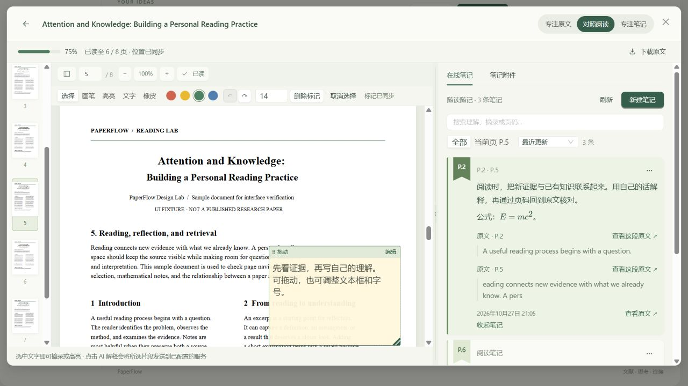
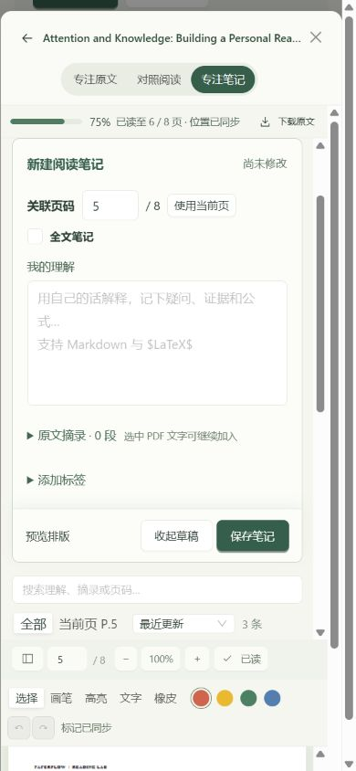

# 最终阶段：阅读体验完善与文档整理

完成日期：2026-10-27。依据：[修改方案](ui-ux-improvement-plan-2026-10-27.md)。

## 完成内容

- 在线笔记第一行改为关联页码，阅读器内新建默认当前页，允许手动修改，也支持全文笔记；移除新笔记的章节输入优先级，旧章节继续保留。
- 编辑中可向当前笔记追加原文，支持跨页、多段来源和重复摘录识别；另建笔记会保留原草稿。每段可独立编辑、移除和回原文。
- 来源跳转使用页码与选区坐标，定位后短暂强调目标句；手动关联只定位页码。来源提示与可删除的 PDF 高亮不再混用一层常驻底色。
- 详情与阅读器共享本机草稿，收起、站内跳转和刷新后可恢复；保存成功才移除对应草稿，空白草稿直接收起。旧 Markdown 编辑器同样保留草稿，缓存损坏按条忽略，存储失败明确提示并保护关闭。
- PDF 文字批注支持选择、拖动、调整文本框、字号与颜色修改、方向键微调。位置与尺寸按页面比例保存，缩放和重开后恢复。旧批注缺少尺寸时使用兼容默认值。
- PDF 标记支持选中、改色、删除和最多 50 步撤销／重做；恢复已删标记后，历史操作同步更新它的标识，连续撤销仍可正常执行。
- 阅读布局切换只调整空间，不强制跳到附件页签；记住布局、页签和分栏宽度。页码框只在按回车时跳转，失焦不再意外翻页。
- 笔记增加搜索、全部／当前页筛选、最近更新／原文页序；理解字号、来源链接、按钮对比度和键盘焦点进一步统一。编辑区收敛到理解主体，保存栏固定可达。
- 文献库保留筛选、排序、页码和返回位置，提供收藏筛选及有效条件提示。首页标签打开筛选结果，最近阅读提供直接进入工作台的入口。
- 统一在线笔记／笔记附件命名，缩略图标题改为“页面”，阅读器显示文献标题；阅读器内可以上传笔记附件。
- README 收敛到项目用途、功能、界面、启动和文档入口。详细说明放入[使用指南](user-guide.md)，历史开发过程通过[记录索引](development.md)引用。

## 数据与兼容

笔记增加第二版多摘录结构，仍保存可读 Markdown，并兼容第一版字段、旧摘录模板和普通 Markdown。用户在正文外部修改后的内容不会被隐藏元数据覆盖。原文关联继续绑定附件，替换文件后提示重新关联。

批注继续使用现有 JSON 几何字段，增加可选宽、高与字号参数；后端验证数值、边界和布尔值混入等情况。不需要清空数据库或重建旧笔记。

本机草稿属于当前浏览器，正式保存后才进入数据库。下载原文仍为原始 PDF；入口已有说明，未实现带批注 PDF 导出。

## 自动验证

| 检查 | 结果 |
| --- | --- |
| 后端完整测试 | 253 项通过 |
| 前端完整测试 | 58 项通过 |
| TypeScript 检查 | 通过 |
| 生产构建 | 通过 |

新增验证覆盖批注尺寸与字号往返、旧几何兼容、越界和非法尺寸拒绝，多段来源保存、旧摘录升级、重复摘录保留理解、手动页码无高亮、草稿恢复／存储失败／损坏缓存、收藏及标签地址往返和直接阅读路由。

构建保留原有首页图表分包超过 500 KB 的提示，不影响构建成功；没有通过调大警告阈值隐藏该提示。

运行命令：

```powershell
# backend
..\.venv\Scripts\python.exe -m pytest -q -p no:cacheprovider --basetemp=instance/final-full-tests

# frontend
npm.cmd test
npm.cmd run build
```

## 浏览器验收

使用独立的 `final-ui.db`、`final-ui-uploads` 和 AI 设置文件，均位于被 Git 忽略的 `backend/instance`。未修改正式文献库或正式 AI 配置。

| 流程 | 实际结果 |
| --- | --- |
| 首页标签 → 文献库 → 只看收藏 → 详情 → 返回 | 标签与收藏筛选保留，结果数量正确 |
| 详情输入理解与 P.2 → 站内跳转 → 返回并刷新 | 显示可恢复草稿，恢复后输入和页码完整 |
| 详情恢复草稿 → 打开阅读工作台 | 两个位置共享同一草稿 |
| 草稿写到一半 → 摘录 P.2 → 再摘录 P.5 → 保存 | 原理解保留，卡片显示 P.2、P.5，两个摘录各有来源 |
| 从第 3 页点 P.5 摘录的原文入口 | 到第 5 页目标句，出现短暂选区强调 |
| 已存笔记重新编辑 | 两段摘录、页码和原理解均可继续修改 |
| AI 解释 → 加入当前理解 → 保存 | 原理解保留，解释追加；使用本地测试替身，不请求外部服务 |
| 添加文字批注 → 移动 → 调整尺寸 → 改字号与颜色 | 交互和保存均正常 |
| 调整批注后撤销、重做 | 文本框恢复相应尺寸 |
| 改字号 → 删除标记 → 撤销删除 → 再撤销字号 | 批注恢复，连续撤销无失效标识问题 |
| 刷新、重开阅读器 | 批注位置、尺寸、字号、颜色恢复 |
| 390×844 | 无页面横向溢出；新建默认当前页，保存栏可见；专注笔记时笔记置顶 |
| 768×1024 | 无页面横向溢出，对照双栏可用，工具栏换行后阅读区仍可滚动 |
| 布局往返切换 | 在线笔记页签保持，空白草稿可直接收起 |

此次覆盖桌面与两种响应式尺寸，没有进行实体手机软键盘、长时间大批量批注或真实模型输出质量的专项测量。

## 预览方式

```powershell
# 项目根目录，独立示例后端；--mock-ai 只在此预览脚本启用
.\.venv\Scripts\python.exe scripts/preview_final.py --mock-ai --port 5003

# 另开终端
cd frontend
$env:PAPERFLOW_API_TARGET='http://127.0.0.1:5003'
npm.cmd run dev -- --port 5176 --strictPort
```

访问 `http://127.0.0.1:5176`。正常使用仍按 README 启动；已经运行的后端需重启一次，使批注尺寸校验更新生效。

## 页面截图




